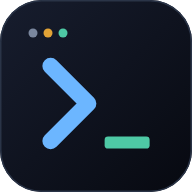

# herdr web ui

<p align="center">
  
</p>

<p align="center">
  <a href="README.md">English</a> · <a href="README.zh-CN.md">简体中文</a> · <strong>日本語</strong> · <a href="README.ko.md">한국어</a>
</p>

<p align="center">
  <a href="https://herdrweb.dev/">公式サイト</a> ·
  <a href="#install">インストール</a> ·
  <a href="https://herdrweb.dev/demo/">デモを試す</a> ·
  <a href="docs/guide.md#quick-start">クイックスタート</a> ·
  <a href="#faq">よくある質問</a> ·
  <a href="#docs">ドキュメント</a>
</p>

<p align="center">
  <a href="LICENSE"></a>
  <a href="https://github.com/devswha/herdr-web-ui/stargazers"></a>
  <a href="https://github.com/devswha/herdr-web-ui/releases/latest"></a>
  <a href="https://github.com/herdrdev/herdr"></a>
  <a href="docs/guide.md#on-your-phone"></a>
</p>

---

https://github.com/user-attachments/assets/d854dbb6-64bd-4eba-81c7-fbd3f525726b

<p align="center"><sub>1 つの Claude Code セッションを、herdr のターミナルからブラウザのターミナルとチャットへ、そしてスマートフォンへ。スマートフォンでは新しい worktree をすぐ隣に起動 · 実際の動作を収録、カットなし</sub></p>

**Claude Code と Codex を、スマートフォンから。**

[herdr](https://github.com/herdrdev/herdr) のブラウザ・スマートフォン向けクライアントです。自分のコンピューターで実行中の同じエージェントセッションを、パソコンでもスマートフォンでもチャットで読んで返答できます。必要なときはターミナルも使えます。

<table>
  <tr>
    <td width="50%" valign="top">
      <a href="https://github.com/user-attachments/assets/32ca9aa4-960f-4629-9fb5-17c12ba35c80"></a>
      <br><b>ライブターミナルに切り替える</b>
      <br><sub>クリック 1 回でチャットがそのペインの本物のターミナルに切り替わり、スマートフォンではキーバーの ↑ でテストのコマンドを呼び出して、隣の Enter で再実行します。</sub>
    </td>
    <td width="50%" valign="top">
      <a href="https://github.com/user-attachments/assets/22d10639-9aa6-4953-a5f3-a1b743f4053b"></a>
      <br><b>herdr のレイアウトをブラウザで</b>
      <br><sub>ワークスペース、タブ、分割ペイン、そして各エージェントの状態がそのまま。タブをクリックし、分割のペインを選び、スマートフォンからワークスペースを切り替えます。</sub>
    </td>
  </tr>
  <tr>
    <td width="50%" valign="top">
      <a href="https://github.com/user-attachments/assets/b228a2b8-6db5-4546-a15b-972056000cab"></a>
      <br><b>エージェントに呼ばれたらすぐ分かる</b>
      <br><sub>別のワークスペースを見ていても、Claude が質問すると通知が降りてきて、タップ 1 回で質問が開きます。</sub>
    </td>
    <td width="50%" valign="top">
      <a href="https://github.com/user-attachments/assets/a193b426-259c-47d9-bd73-10acc2594265"></a>
      <br><b>スマートフォンからスクリーンショットを送る</b>
      <br><sub>+ ボタンでペインのフォルダーにアップロードしてパスを挿入。Claude が画像を読みます。</sub>
    </td>
  </tr>
  <tr>
    <td width="50%" valign="top">
      <a href="https://github.com/user-attachments/assets/bc419d3e-ebda-4fb5-acc5-e498609559fe"></a>
      <br><b>エージェントが作ったファイルを開く</b>
      <br><sub>ターミナルのパスをクリック、またはチャットのパスをタップすると、その場でファイルが開きます。</sub>
    </td>
    <td width="50%" valign="top">
      <a href="https://github.com/user-attachments/assets/150a4c9d-7667-4f63-ba56-8f91e6a25878"></a>
      <br><b>2 つ目のエージェントを分岐させる</b>
      <br><sub>スマートフォンで ⋯ → New worktree。ブランチは入力済み、エージェントを選べば最初のものの隣で起動します。</sub>
    </td>
  </tr>
</table>

<p align="center"><sub>どのクリップも、パソコンとスマートフォンを同時に収録した実際の動作です。等速・カットなし。クリックすると動画全体を再生できます。</sub></p>

- **チャットとターミナルを、ひとつのペインで** — Claude Code、Codex、omp、omo、gjc、pi、Hermes の会話履歴と、特定できた OpenCode、Devin CLI のセッションを表示します。Linux の Grok と実験的な Antigravity（agy）も、後述の条件で対応しています。ワンクリックで同じペインのターミナルに切り替えられます。作業中のメッセージはキューに入れて次のターンで送るか、Send now ですぐに送れます。[対応エージェント →](docs/guide.md#supported-agents)
- **タップで承認** — 対応する承認リクエスト、質問、計画メニューがカードになり、問いかけがまだ有効か確認してから回答を送信します。カードに対応していない要求にはターミナルで回答します。
- **対応が必要なときに通知** — すべてのペインの状態をリアルタイムに表示し、アプリを開いているときは通知が上から降りてきます。入力が必要なときや完了したときには、アプリを閉じていてもプッシュ通知が届きます。
- **スマートフォンにインストール** — キーボードの上にキーバー（Esc、Tab、Ctrl、Alt、Shift、Enter、矢印キー）が並ぶ PWA。キーの並べ替えや独自のキー組み合わせの追加は Settings（設定）でできます。Tailscale のアドレスは QR コードで表示されます。[スマートフォンの設定 →](docs/guide.md#on-your-phone)
- **話して入力** — チャットやターミナルの入力欄に音声で入力できます。日本語などの認識言語を選べ、コード用語の英語も認識対象になります。文字起こしした文章は入力欄に入り、エージェントへ自動送信されることはありません。自分の OpenAI API キー、またはブラウザの音声認識を使います。録音などの外部送信については[音声入力](docs/guide.md#voice-input)を参照してください。
- **リポジトリの変更を確認** — ファイルブラウザーから作業ツリー、ステージ済みの変更、コミット間の比較を開き、リポジトリを変更せずにファイルごとの差分を読めます。
- **いつもの作業環境をそのままに** — エージェントは herdr が管理し、このアプリはそこに接続します。エージェントを止めずに Settings（設定）からアップデートでき、アップデートごとの変更はパッチノートで確認できます。新しいタブや worktree は行の ⋯ メニューから作れます。[すべての機能 →](docs/guide.md#features)

---

<a id="install"></a>

## インストール

```bash
curl -fsSL https://herdrweb.dev/install.sh | sh
```

glibc を使う Linux（x64、arm64）と macOS（Intel、Apple Silicon）に対応しています。Alpine（musl）と 32 ビット ARM は対象外です。`curl`、Git、`tar` が必要で、Bun がない場合は Bash と `unzip` も必要です。必要なバージョンは herdr 0.9.0+、Bun 1.4+、Node 18+ です。不足するツールを現在のユーザー向けにインストールし、古い Bun は更新します。Node がない、または 18 より古い場合は Node 22 をインストールし、その後アプリを herdr プラグインとしてインストールします。既存の herdr が 0.9.0 より古い場合は、自分で herdr を更新・再起動してからインストーラーを再実行してください。

デフォルトの待ち受けアドレスを使用し、Tailscale が起動している場合、HTTPS の設定に成功すると tailnet 内のアドレスと QR コードが表示されます。トークンを設定していない場合、`tailscale serve` がこの PC の所有者と同じログイン名を伝える自分のデバイスは、通常コードなしで接続できます。それでも自分のスマートフォンがペアリングを求められる場合、`HERDR_WEB_TAILSCALE_SERVE_ONLY=1` でログイン情報のない接続を許可できるのは、Tailscale が単一のログインの所有する tailnet でタグ付きノードもないことを確認でき、serve がこのポートへの唯一の経路である場合だけです。公開プロキシやトンネルなど別の経路でこのポートに届く場合は設定しないでください（[アクセスと安全性](docs/guide.md#access-and-safety)）。

Windows x64 では PowerShell で:

```powershell
irm https://herdrweb.dev/install.ps1 | iex
```

[Git for Windows](https://git-scm.com/download/win) が必要です。足りない herdr と Bun を現在のユーザー向けにインストールし、同じプラグインをインストールします。Node や WSL は不要です。スマートフォンから使うには herdr で **Phone setup** を開いてください。herdr が Windows でターミナルのアタッチに対応するまで、Windows のターミナルは入力でき、グリッドが固定された[画面ミラー](docs/remote-pcs.md#windows-pcs)になります。

<p align="center">
  
</p>

herdr 0.9.0+、Bun 1.4+、Node 18+ がすでにそろっている場合は、プラグインだけをインストールできます。Windows では Node は不要です。

```bash
herdr plugin install devswha/herdr-web-ui
```

古い herdr は先に更新・再起動してください。各手順と問題の対処方法は [INSTALL.md](INSTALL.md) を参照してください。

herdr が起動した状態で、インストーラーが表示または開いたアドレスを使います。通常は **[127.0.0.1:7317](http://127.0.0.1:7317)** ですが、そのポートが使用中ならプラグインは別のポートを選んで記憶します。プラグインだけをインストールした場合は、herdr の **Start herdr web ui** を実行してください。デスクトップ環境のある PC への新規インストールではブラウザーが自動で開きます。アドレスバーの **Install** でアプリを追加し、同じアドレスを使い続けてください。`127.0.0.1` と `localhost` はブラウザーにとって別のアプリのアドレスです。自動で開くのを省くには、インストール前に `HERDR_WEB_NO_OPEN=1` を設定します。ペインを選ぶか、**New workspace（新規ワークスペース）** からエージェントを起動してください。スマートフォンではインストーラーの QR コード（herdr の **Phone setup** でも確認できます）を読み取り、ホーム画面に追加します。[クイックスタート →](docs/guide.md#quick-start)

サーバーのデフォルトの待ち受けアドレスは `127.0.0.1` です。別のデバイスからアクセスする場合は、[スマートフォンの設定](docs/guide.md#on-your-phone)と[アクセスと安全性](docs/guide.md#access-and-safety)を参照してください。

<a id="faq"></a>

## よくある質問

**Claude Code や Codex をスマートフォンから使えますか？**

はい。コンピューターの [herdr](https://github.com/herdrdev/herdr) のペインでエージェントを動かすと、このアプリが同じペインをスマートフォンのブラウザに表示します。エージェント自身の会話履歴はチャットとして、承認や質問はタップして答えるカードとして表示され、ライブターミナルにもすぐ切り替えられます。PWA としてホーム画面にインストールでき、エージェントが入力を待つとプッシュ通知が届きます。[スマートフォンの設定 →](docs/guide.md#on-your-phone)

**チャット表示はどのエージェントに対応していますか？**

Claude Code、Codex、omp、omo、gjc、pi、Hermes は各自のセッションストアを読み取ります。GJC のチャットには GJC 0.18.9 以降、サーバー PC の PATH 上の `gjc` と Git、起動済みの SDK ブローカーが必要です。セッションを一意に特定できなければターミナルを表示します。OpenCode は、対応する 2.x および 1.x の SQLite スキーマから herdr が報告したセッションを読み取ります。開始画面、セッション ID がない場合、未対応・読み取り不能・サイズ制限超過のストアではターミナルを表示します。Devin CLI は `devin --resume <id>` のように herdr または実行中のプロセスがセッションを明示する場合にチャットを表示し、単に `devin` で起動した場合はターミナルを表示します。

Grok のチャットは Linux のみで、プロセスが保持するセッションが 1 つだけで、herdr の報告と一致する場合に対応します。macOS、Windows、セッションを一意に特定できない場合はターミナルを表示します。Antigravity（agy）は実験的な対応で、実行中のプロセスが保持する会話ロックから履歴を特定します。Linux は実機検証済み、macOS は未検証、Windows はターミナル表示です。対応していない、または読み取れる履歴がない場合もターミナルを表示します。[対応エージェント →](docs/guide.md#supported-agents)

**herdr の TUI の代わりになるものですか？**

いいえ。どちらも同じターミナルに同時に接続するので、ペインは机の上でも、ブラウザでも、スマートフォンでもそのまま動き続けます。止めたり引き渡したりするものはありません。 [TUI とブラウザ →](docs/guide.md#faq)

**Tailscale は必須ですか？**

いいえ。Tailscale、SSH トンネル、VPN、または自分で設定した HTTPS プロキシで PC に接続できます。Portal 2.6.1 以降を別途インストールすれば、任意の [Portal 連携](docs/guide.md#behind-a-reverse-proxy)で公開 HTTPS アドレスを管理することもできます。`HERDR_WEB_TOKEN` と信頼できるリレーが必要で、`HERDR_WEB_TAILSCALE_SERVE_ONLY` は無効にする必要があります。アプリのインストールとプッシュ通知には HTTPS や localhost などのセキュアなコンテキストが必要ですが、基本的な閲覧は LAN 上の通常の HTTP アドレスでもできます。[ほかの方法 →](docs/guide.md#faq)

**コードや会話が自分のマシンの外に出ることはありますか？**

セッションファイルは各エージェントを実行している PC に残り、その内容は接続したブラウザーへ送られます。このアプリ独自のクラウド中継やアカウントサービスはありません。任意の音声入力は録音を、文章の整形も使う場合はテキストも、設定したプロバイダーへ送ります。ブラウザーの音声認識もブラウザー提供元のサービスを使う場合があります。使用量表示はプロバイダーの API に接続し、更新、リモート PC の設定、プッシュ通知も外部サービスを使うことがあります。Portal を有効にすると、接続は選んだリレーを経由します。リレーは接続のメタデータを確認でき、アドレスの証明書を保持するため、信頼できるリレーを使ってください。

匿名の使用状況の集計はデフォルトで有効です。アプリ内で通知を表示し、10 分の猶予期間を置いてから、インストール・更新の集計を送信できます。ランダムなインストール ID、バージョン（更新前のバージョンを含む）、OS、CPU アーキテクチャ、インストール方法、許可リストにあるアプリ設定のスナップショットが含まれます。独自のテキストやアカウント識別子は省略または要約し、コード・会話・ファイルは収集しません。リポジトリ内の受信サーバーは Cloudflare が提供する国コードを追加しますが、IP アドレスは保存しません。アクティビティの集計には、アプリを開いた日（UTC）のエージェントの種類が含まれ、新しい種類が現れると同じ日の集計を再送することがあります。**Settings → About → Anonymous usage counts** で内容を確認して無効にでき、`HERDR_WEB_TELEMETRY=0` または `DO_NOT_TRACK=1` でも停止できます。エージェント自身のモデルへの接続は、そのエージェントの設定によります。[データの送信とアクセス →](docs/guide.md#faq)

ランダムな ID で同じインストールの集計を関連付けられるため、完全な匿名性を保証するものではありません。

**Windows でも動きますか？**

はい。Windows x64 で、WSL なしで動きます。herdr が Windows でターミナルのアタッチに対応するまで、ターミナルは入力ができる固定グリッドの[画面ミラー](docs/remote-pcs.md#windows-pcs)です。

**collie、roamgate、herdr-remote とは何が違いますか？**

これらも herdr をスマートフォンやブラウザーから使うためのクライアントです。このアプリはエージェント自身の会話履歴を読み、作業がターンごとに折りたたまれたチャットを表示し、ほかの PC はサイドバーから SSH で追加します。リポジトリの差分表示に対応し、別途インストールした Portal トンネルも管理できますが、扱うのは herdr のみで、トンネル自体は同梱しません。tmux、zellij、Telegram が必要なら、ほかのクライアントの対応範囲を比較してください。[詳しい比較 →](docs/guide.md#faq)

**Happy、Paseo、CloudCLI UI とは何が違いますか？**

これらのプロジェクトには、エージェントのセッションを開始・管理する独自の仕組みがあります。このアプリは、すでに動いている herdr のペインを表示し、TUI とブラウザで同じターミナルを使い続けられます。herdr を使っていなければ、それらの導入方法と対応エージェントを比較してみてください。[詳しい比較 →](docs/guide.md#faq)

<a id="docs"></a>

## ドキュメント

まずは[ユーザーガイド](docs/guide.md)をご覧ください：[クイックスタート](docs/guide.md#quick-start) · [対応エージェント](docs/guide.md#supported-agents) · [機能](docs/guide.md#features) · [スマートフォン](docs/guide.md#on-your-phone) · [リモート PC](docs/remote-pcs.md) · [アクセスと安全性](docs/guide.md#access-and-safety) · [設定](docs/guide.md#configuration) · [キーボードショートカット](docs/guide.md#keyboard-shortcuts) · [よくある質問](docs/guide.md#faq)。

さらに詳しく：[仕組み](docs/guide.md#how-it-works) · [チャットの会話履歴](docs/chat-mode-audit.md) · [ターミナルのフロー制御](docs/terminal-flow-control.md) · [アプリのアップデート](docs/app-updates.md) · [変更履歴](CHANGELOG.md)。

<a id="thanks"></a>

## 謝辞

[herdr](https://github.com/herdrdev/herdr) を基盤とし、[chatmux](https://github.com/devswha/chatmux) から着想を得て、[xterm.js](https://xtermjs.org)、[React](https://react.dev)、[Bun](https://bun.sh)、[Lucide](https://lucide.dev) を使用しています。

[@Yoonwoo-Ha](https://github.com/Yoonwoo-Ha) をはじめ、貢献してくださったすべての方に感謝します。

<a id="agent-instructions"></a>

## エージェント向けの手順

アプリのインストールを支援する場合は、[INSTALL.md](INSTALL.md) に従ってください。リポジトリを変更する場合は、[CONTRIBUTING.md](CONTRIBUTING.md)、[レビュールール](.github/REVIEW.md)、[AGENTS.md](AGENTS.md) に従ってください。

<a id="development"></a>

## 開発

```bash
git clone https://github.com/devswha/herdr-web-ui.git
cd herdr-web-ui
bun install

bun run server      # API + WebSocket on :7317
bun run dev         # Vite on :5173; run in a second terminal
```

```bash
bun run typecheck
bun run test:unit   # no herdr needed
bun test           # isolated herdr test session
bun run test:ui    # browser regression checks
```

変更の送り方は [CONTRIBUTING.md](CONTRIBUTING.md)、テスト、メディア素材、リリースについては[開発ドキュメント](docs/development.md)、UI の規約については [DESIGN.md](DESIGN.md) を参照してください。セキュリティの問題は [SECURITY.md](SECURITY.md) の手順で非公開で報告してください。

<a id="license"></a>

## ライセンス

[MIT](LICENSE)。Copyright © 2026 devswha.
