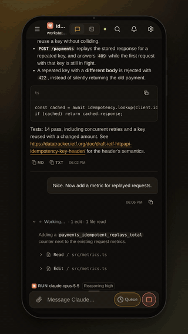
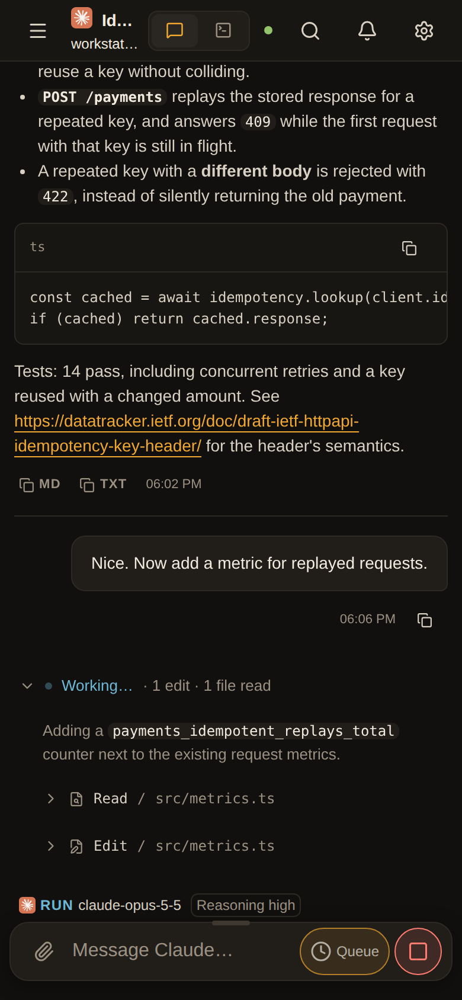
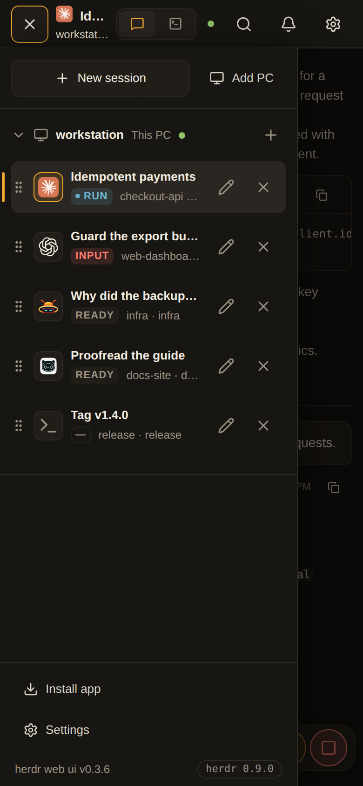
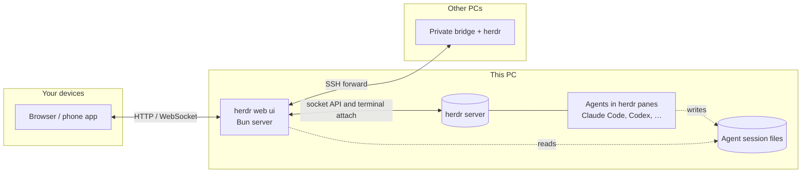

# User guide

[← README](../README.md) · [Quick start](#quick-start) · [Supported agents](#supported-agents) · [Features](#features) · [Phone](#on-your-phone) · [Remote PCs](#remote-pcs-over-ssh) · [Access and safety](#access-and-safety) · [Configuration](#configuration) · [Updates](#updates) · [Keyboard shortcuts](#keyboard-shortcuts) · [How it works](#how-it-works) · [FAQ](#faq)

Install, connect and use herdr web ui on your desktop and phone.

## A look around

<table>
  <tr>
    <td colspan="2"></td>
  </tr>
  <tr>
    <td colspan="2" align="center"><b>Chat</b>: the agent's own transcript, each turn's work folded into one line you can open</td>
  </tr>
  <tr>
    <td width="50%"></td>
    <td width="50%"></td>
  </tr>
  <tr>
    <td align="center"><b>Answer prompts</b>: approvals and questions become cards, answered from the chat</td>
    <td align="center"><b>Terminal</b>: the same pane, live, through<br><code>herdr terminal attach</code></td>
  </tr>
</table>

<p align="center">
  
  
  
  
</p>

<details>
<summary><b>▶ Watch the demos in HD</b> (desktop 1920×1200, phone 1080×1920)</summary>

https://github.com/user-attachments/assets/4ca73671-ebfc-4c18-b8f2-99331abf9fa7

https://github.com/user-attachments/assets/2f030569-1004-425e-835d-9e775ec6e4c8

</details>

## Quick start

> **Want a look first?** [Try it in your browser](https://herdrweb.dev/demo/): the app on a fictional session, nothing to install. Nothing in it is live.

> **Setting it up with a coding agent?** Point it at [INSTALL.md](../INSTALL.md), a step-by-step guide written for agents.

**1. Install it** with one line, on Linux (x64, arm64) or macOS:

```bash
curl -fsSL https://herdrweb.dev/install.sh | sh
```

It does, in order, only what is not done yet:

- **What it runs on.** [herdr](https://github.com/herdrdev/herdr) 0.9.0+, [Bun](https://bun.sh) 1.4+ and Node 18+ (Node runs the terminal sidecar). A missing one is installed for your user only, without sudo: herdr and Bun by their own installers, into `~/.local/bin` and `~/.bun`, and Node 22 from nodejs.org, checked against its published SHA-256, into `~/.local/share/herdr-web-ui/node`. Nothing is compiled.
- **The app**, as a herdr plugin at the latest release (set `HERDR_WEB_UI_REF` to install another branch or tag): herdr builds it and starts it along with itself, on `127.0.0.1:7317`, following the socket of the current herdr session. When herdr is already running, the app starts now.
- **The phone address.** When Tailscale runs on this PC, it serves the app to your tailnet (`tailscale serve`, see [On your phone](#on-your-phone)), tells you the command that undoes it, and prints the address as a QR code. Without Tailscale, it says what to set up.

- **The app in your browser.** On a new install, on a PC with a desktop, it opens `http://127.0.0.1:7317` in your browser and says so: click **Install** in the address bar to add the app. It doesn't open anything in CI, over SSH, or when `HERDR_WEB_NO_OPEN=1` is set; then it prints the address instead. Over SSH it prints the tunnel to run from your own computer, `ssh -L 7317:127.0.0.1:7317 <this-pc>`, after which `http://127.0.0.1:7317` there opens the app and its **Install** button.

Run it again at any time, for example after setting up Tailscale: it keeps what is there and prints the address and QR code again.

On a first install it mentions a GitHub star, once, unless the account the [gh CLI](https://cli.github.com) is signed in to has starred the repository already. When gh is signed in and that account has not, it also asks at the terminal whether to star it, and does so only if you answer `y`. It never stars by itself. Without a terminal, as when a script runs it, it does not ask, and a question nobody answers goes on after 20 seconds.

<p align="center">
  
</p>

<sub>A PC named fresh-pc on a sample tailnet (alice@example.com): the names and the QR code are placeholders.</sub>

<details>
<summary>Other ways to install</summary>

**The plugin alone**, when herdr, Bun and Node are there already. After installing, choose
the plugin's **Phone setup** action inside herdr to see the address, QR and a pairing code.

```bash
herdr plugin install devswha/herdr-web-ui
```

**From a checkout:**

```bash
git clone https://github.com/devswha/herdr-web-ui.git
cd herdr-web-ui
bun install
bun run start
```

You need herdr 0.9.0+, Bun 1.4+ and Node 18+, and herdr must be installed and running first: start it with `herdr`. `start` builds the client and runs the server under the update supervisor. It talks to `~/.config/herdr/herdr.sock` unless `HERDR_SOCKET` says otherwise. If herdr isn't running there, the app still opens, but its header shows **herdr offline** and the page says it cannot reach herdr at that socket.

</details>

**2. Open it** at **http://127.0.0.1:7317**, the address the installer opened. The installed app belongs to that exact address: `localhost:7317` is another address to the browser, so a tab there still offers **Install**. Every workspace of your herdr session is a row in the sidebar, as in herdr's own, led by its project's icon when its folder keeps one (a favicon in the folder, `public/` or `static/`; else an app icon such as Next.js's `app/icon.*` or Electron's `build/icon.png`; else a logo such as `logo.svg` or `assets/logo.png`; the folder is the worktree checkout, or else the pane's working folder, so a pane that has `cd`'d into `src/` looks there) and a folder glyph otherwise (a repository row with worktrees under it is also its fold button: the folder opens and closes with it, and an icon turns into that folder under the pointer; the worktree rows nested under it have no mark); its tabs are always shown in a strip, and the active tab shows all its split panes together. Pick one, start a new agent with **New workspace**, or add a tab to a workspace with **New tab** (the strip's `+`, a tab's right-click menu, or the command palette on a wider screen or with a keyboard). Right-click a tab to rename or close it; on a phone, tap the selected tab’s **⋯** for a trimmed menu with pane actions, Rename tab and Close tab. A focused tab also opens its menu with Shift+F10, and double-click still renames it.

Drag a tab to change its order within the workspace, or choose **Move tab left / right** from
its menu (also on a phone). Alt+Shift+Left/Right moves a focused tab. Reordering keeps the
selected pane and saves the order in herdr.

Right-click a pane to rename it, split right or down, zoom it, or close it. Right-clicking another
pane keeps the current focus, so **Swap with focused pane** exchanges the two. Drag a boundary
to resize it. On a touch screen, the pane header's **⋯** opens the same menu; on a phone the tab's **⋯** carries
the open pane's Rename and Close, while split and zoom stay with a screen that shows panes side by
side. **Unzoom pane** stays in the phone's tab menu when the tab is zoomed, so its other panes
remain reachable. **Zoom pane** makes a small pane fill the screen, and **Unzoom pane** restores the split. A split opens the new pane.
Each pane keeps its own Chat/Terminal view and unsent draft.

To see two panes side by side, drag a workspace row, an **Agents** row, a tab, a pane's title or
a half's bar onto the left or right half of the pane area. A pick in the sidebar or the **Agents**
list then opens in the active half only, and the focus stays there. Both halves can show the same
tab, and you type in whichever half is active; the other half shows that tab at the active half's size.


**3. Take it with you.** Scan the installer's QR code with a phone signed in to the same Tailscale account, then install the app from the browser. See [On your phone](#on-your-phone).

### In a terminal

**The phone address, again:** run the one-line installer again. On a PC where the app is installed it installs nothing and prints the address and its QR code, serving the app to your tailnet first if nothing does yet. It finds the version that actually runs: herdr's plugin directory keeps the version first installed, and **Settings → Updates** runs newer ones from `~/.config/herdr-web-ui/updates`. From a checkout, `bun scripts/plugin.ts phone` does the same.

**A pairing code, on a PC with no browser of its own:**

```bash
root=$(herdr plugin list --json | bun -e 'const d = JSON.parse(await Bun.stdin.text()); console.log(d.result.plugins.find((p) => p.plugin_id === "devswha.herdr-web-ui")?.plugin_root ?? "")')
bun "$root/scripts/plugin.ts" pair   # plugin install
bun scripts/plugin.ts pair           # from a checkout
```

`pair` prints the code, the address the phone opens when Tailscale serves one, and that address as a QR code. Neither is a herdr action: herdr keeps an action's output in its log, and a pairing code belongs on the screen. The actions start, stop and report on the server:

```bash
herdr plugin action invoke devswha.herdr-web-ui.start    # leaves a running server alone
herdr plugin action invoke devswha.herdr-web-ui.status
herdr plugin action invoke devswha.herdr-web-ui.phone    # visible phone setup pane
herdr plugin action invoke devswha.herdr-web-ui.stop
```

Its PID and log live under `HERDR_PLUGIN_STATE_DIR`. For persistent settings (see [Configuration](#configuration)), add `KEY=value` lines to the `env` file (no dot) in the directory that `herdr plugin config-dir devswha.herdr-web-ui` prints. A plugin checkout from 0.3.25 on also reads `.env` there, which wins where both set a key; an older one needs a plugin reinstall first, since in-app updates do not replace the checkout. The plugin's `status` prints the files it read. Protect that file if it holds a token.

### Uninstall

```bash
herdr plugin action invoke devswha.herdr-web-ui.stop
herdr plugin uninstall devswha.herdr-web-ui
tailscale serve --https=<port> off    # the port the installer printed, if it served the app
```

The installer's herdr, Bun and Node stay, since other tools may use them: `~/.local/bin/herdr`, `~/.bun`, and `~/.local/share/herdr-web-ui/node` with its link `~/.local/bin/node`. Push keys, paired devices and the identity file that owns the app's Portal address are in `~/.config/herdr-web-ui`.

## Supported agents

Every agent herdr runs shows up with its live status, terminal and alerts. The chat view reads the agent's own session files wherever it knows where they are:

| Agent | Chat | Answer prompts from chat |
| --- | --- | --- |
| **Claude Code** | Native transcript, resolved through herdr | ✓ approvals, questions, plan and menu picks, and the `/model` list (picked for the session) |
| **Codex** | Native rollout, with tool results and commentary/final phases | ✓ approvals and questions, including queued ones, and the `/model` lists (picked for the session) |
| **omp** | Native session file | ✓ |
| **omo** | Native session file, found through the pane's process tree | ✓ the `/model` list (picked for the session); other menus — use Terminal |
| **gjc** | Native session file identified by GJC's SDK broker and the pane's process | — use Terminal |
| **pi** | Native session file, resolved through herdr; after `/tree`, the branch in play | ✓ its dialogs: a question, a confirmation, an answer typed in |
| **OpenCode** | Native session in OpenCode 2's own database, resolved through herdr: `~/.local/share/opencode/opencode.db` (`%USERPROFILE%\.local\share\opencode\opencode.db` on Windows), or where the server's `XDG_DATA_HOME` or `OPENCODE_DB` puts it | ✓ its questions on OpenCode 2.0 or later, answered through its background service (`~/.local/state/opencode/service.json`, or under the server's `XDG_STATE_HOME`) one question at a time, with Back to change an earlier one; other prompts, and OpenCode 1 — use Terminal |
| **Devin CLI** | Native SQLite session, showing the active branch when herdr or the live process explicitly identifies the session; otherwise terminal text | — use Terminal |
| **Grok** | Linux native update log. Any Grok executable named `grok` or `grok-…` that holds the `events.jsonl` for the session Herdr reported in exactly one directory, with a newer write time than every other held session. Older open files do not hide it; ambiguous IDs, tied times, and an unreported `/resume` use Terminal until Herdr names the confirmed session. macOS and Windows use Terminal. See [Grok setup and limits](grok-chat.md). | — use Terminal |
| **Hermes** | Native SQLite session store | — use Terminal |
| **Antigravity (agy)** | **Experimental; macOS untested.** Native ledger, selected by the running process’s held conversation lock. Linux native-tested; Windows uses terminal text. See [Agy behavior and limits](agy-chat.md). | — use Terminal |
| **Anything else** | The terminal's text | — use Terminal |

GJC chat requires GJC 0.18.9 or later for its broker-bound SDK session CLI, with `gjc`
on the server PC's PATH and its SDK broker already running. An older GJC opens in Terminal.
Git must also be on PATH for the SDK's workspace-scope discovery.
The bridge asks the broker which saved session belongs to the pane's GJC process;
it does not start a broker or guess from the screen, session title or newest file.
Missing, ambiguous or unreadable SDK identity uses Terminal instead. Terminal input,
status tracking and prompt handling are unchanged.

Devin sessions are never selected by directory or recency alone. A plain `devin` shows the
terminal text, since herdr does not report its session without its Devin integration; a session
started with `devin --resume <id>` (or `-r <id>`, as Devin suggests when it exits) is a chat.
Missing, ambiguous or
unreadable history uses the terminal-text fallback, including histories beyond the reader's
5,000-node or 8 MiB bounds. Long tool output is shortened with a truncation marker; use
Terminal for the rest. The database is opened read-only, though SQLite may create its
WAL coordination files beside it.

When the last visible line is a familiar password, SSH passphrase or PIN request, both
views show a **Password or PIN** field. It hides what you type and sends it directly
to the terminal with Enter. The value is cleared on send, cancel, disconnect, pane
change or when the page goes into the background. It never enters the message queue,
draft storage or chat history. A changed prompt or busy pane refuses the send; check
the terminal before entering it again. **Cancel** sends Ctrl+C. Remote PCs need bridge
bundle v6. Detection covers a narrow list of English prompts, not every program or language.

A ring by the message box shows how much of the model's context the last request filled, and
its exact token counts on a tap. A pi pane shows it once `~/.pi/agent/models.json` states that
model's window, which is the file pi reads its own providers from; a model it states no window
for shows no ring rather than a guessed one, because pi answers those from a catalogue or a
running llama.cpp server that this app cannot ask. The model and reasoning effort come from what the session recorded, never from answer text. A todo list shows where the agent recorded it, in the turn's work block: Claude Code's `TodoWrite`, Codex's `update_plan`, or omp, omo and gjc todo calls. Plain-text plans are not reconstructed, and Claude Code `TaskCreate` / `TaskUpdate` calls are not drawn in the work block: the task list they build is the pane's plan, below. Details and verification are in the [chat-mode audit](chat-mode-audit.md).

Background tasks have a button by the message box, with a count while some run: an OmO pane's `task` children, and a Claude Code pane's subagents (the `Agent` tool), read from the session's own files. A Claude Code pane's background commands (`run_in_background`, Ctrl+B, or one moved there by its timeout) are listed with them. It lists what runs and the newest ten that ended in the last day, and the sidebar badge shows the running count. A Claude Code turn that ends while work it started still runs reads **BG**, not DONE: that work's notice starts the next turn by itself, and the finish is alerted once, when that turn ends (a turn is held at most 30 minutes). A subagent that ends leaves a card in the chat with its answer, and a Claude Code subagent whose pane no longer runs that session reads as lost.

A pane's plan is the task list a Claude Code agent keeps (`TaskCreate` / `TaskUpdate`) or the checklist Codex keeps (`update_plan`), read back from the session's transcript. While there is one, the background-task button by the message box starts with **Plan** and how many of its steps are done (`2/5`); the same button opens one list with the plan's steps first and the background tasks below. Steps are listed so a step comes after the steps it waits on (Claude Code's `blockedBy`; a Codex step waits on the one before it). The running step says what it does now, and each step shows how long it took. The sidebar row carries the same count. Claude Code empties its task list once every task is done, and so does this: the first task after that starts a new plan. A teammate of an agent team that changes a task writes that in its own transcript, which is not read.

## Features

| | |
| --- | --- |
| **Read the conversation** | Prompts and Markdown answers (links, code blocks, tables). Each turn's commands, edits and progress are folded into one "Worked for …" block. Copy an answer as Markdown or plain text. In a pi pane, a picture the agent's own tool opened shows inside that tool's row. A picture opens in a full-screen viewer: zoom at the pointer, pan, step through the message's other pictures, **Copy image** and **Download**. Skill names an answer writes (`/name`, or `$name` for Codex) show as chips when the pane's own command list names that skill. Once you have sent four or more messages, a rail of dashes at the left, one per message you sent, jumps between them (not on a phone, or when the chat column leaves less than 32 px of margin at each side). |
| **Follow the plan** | A supported todo-tool call folds into the turn's work block like any tool: it reads as the done count or the step it took, and opened, as the whole list by phase. |
| **Drop into the real terminal** | xterm.js on the live pane: full-screen TUIs, raw keys and herdr's scrollback, shared with your own herdr TUI. Drag to select and it is copied on release; the wheel or the screen's edge scrolls further back while you drag. Ctrl+C copies a selection instead of interrupting. **Quote in message**, shown while text is selected, adds the selection to that pane's chat draft in a code block headed by the pane name, and its line numbers when herdr reports them; nothing is sent. |
| **Find in terminal** | **More → Find in terminal** or Mod+Shift+F searches literal text in herdr's history, with a match count, previous/next navigation and visible match highlights. Search jumps and scrolling move the same viewport in every attached client, including the TUI. Older bridges retain search navigation without automatic highlights. |
| **Jump across PCs** | The command palette (Mod+Shift+K) searches all connected PCs at once by PC, workspace, branch, tab, pane title or agent kind. PC names distinguish results, and Recent remembers each pane's PC. Picking a result opens that PC and pane directly. Disconnected PCs are omitted; app and plugin actions remain on the currently selected PC. It also finds Settings pages and actions by related words (try `theme` or `font`), and browses folders: type a path such as `~/`, or pick **Browse folders**, and the folder you reach opens in Files. |
| **Answer prompts** | Approval, question and plan menus become cards. Tap an option, or type its number in the composer. The server checks that the menu is still current before answering. |
| **Compose** | `/` commands and `@` file mentions, any file or image up to 32 MB attached by path, and a draft per pane. Send during work schedules a next-turn message; use its ↑ Send now action to send it now. A strip under the input card names the pane's working folder (the whole path on hover) and, for a workspace of a repository with a worktree open, its branch at the other end; a phone leaves it out. |
| **Follow every agent** | Live RUN / INPUT / DONE / READY status for all panes, and alerts when an agent needs input, finishes or its terminal ends. |
| **Open what agents make** | A file path in an answer opens in a viewer (images, video, audio, PDF, text), or find it with **Browse files**, and download it to your phone. A source file opens whole up to 8 MB and 200,000 lines; past 2,000 lines it scrolls as a window of rows, colored up to 256 KB and 5,000 lines and plain beyond. A link with `:line` or `#L12` opens at that line. |
| **See what changed** | **Browse files → Changes** lists what changed in the git repository the pane sits in: the **Working tree**, what is **Staged**, or two **Commits** you name, as a folder tree with git's status letter and the added and removed lines. A row opens its diff, **Unified** or **Split** (Settings → Chat → File viewer → Diff layout; a phone shows one column), with **Copy path**, **Copy patch** and **Open file**. The files a turn's edit tools changed, listed in its work block, open the same diff. It only reads; a remote PC's repository is read on that PC. |
| **Manage sessions** | Start an agent in a folder you type or pick with **Browse**. In New workspace, Browse filters the currently loaded folders as you type (case-insensitive); opening a folder updates Directory, so **Start** uses that path even without **Use this folder** (which closes Browse), and a folder under home stays written as `~/…`. **New folder** (the folder-plus button in Browse's bar) makes a folder inside the one shown and opens it. It does not search subfolders or folders beyond the displayed 500. Add a tab to a workspace (as herdr's prefix+c), switch tabs from the strip over the pane, rename workspaces from their ⋯/right-click menu and panes from their own menu, reorder workspaces (drag a row, or on a phone long-press it and drag; Alt+Up/Down moves a focused row one step), and jump anywhere from the command palette. |
| **Speak instead of typing** | A mic beside Attach in the composer and beside Send in the terminal input line. Hold to talk or tap twice; the words land at the caret and are never sent by themselves. See [Voice input](#voice-input). |
| **Watch your plan limits** | Beside the Settings gear, how much of each AI subscription signed in on the PC is left, or used: the session's or the week's limit per account, and every limit with its reset time on a tap. See [Subscription usage](#subscription-usage). |
| **Make it yours** | English, Korean, Japanese or Simplified Chinese, following the browser or chosen in Settings. Dark, light or system mode, with a dark theme and a light theme picked from Amber, Charcoal, Catppuccin and herdr's built-in themes, compact density, interface size, terminal and chat fonts and sizes (Chromium lists the installed fonts to pick from), a resizable composer, Enter behavior and thinking visibility. |

Every agent has the same chat controls on desktop and phones: Stop while it works with an empty
draft, Send when you type, and Send at rest. With a draft in the box, Escape stops the agent. Sending during work adds a message bubble above the
input card. It waits for the current response, then goes to the agent's next turn. Use a pending message's
**↑ Send now** action to send it now. The bridge immediately delivers it; when the agent reads
it is controlled by that agent, so this does not promise instant interruption. The small X discards it.
The bridge claims the same message ID for Send now and an automatic send, so they cannot both
deliver it. Older bridges keep the draft and ask for an update instead of changing queueing into
an immediate send. Connection loss pauses automatic delivery; uncertain text can be copied or
discarded after checking the terminal. Previously held browser messages still need **Send now**
or **Discard**. A message is never pasted over text typed in Claude Code's own input box: while
that box holds a draft the message stays in the list with the reason, and **Send now** delivers it
once the draft is sent or cleared in the terminal.

## Subscription usage

On a local desktop pane, the composer shows a compact read-only limit for the agent's provider:
its plan-wide five-hour session first, or its week when no session is reported. It uses the first
visible account in Settings order; it does not identify the pane's active sign-in. Its hover text
names that account and the reset times. Details stay in the strip beside Settings. Phones and
remote panes do not show this compact reference; failed or unavailable limits are omitted.


The strip beside the **Settings** gear shows the plan limits of the AI tools signed in on the PC the app's server runs on: for each account its provider's logo and one limit, what is left of its 5-hour session by default, or its week, or the share used, as chosen in Settings (red from 80% used). As many accounts show as the row has room for, the rest as `+N`; hovering the strip also names a limit near its end that a chip does not show. A plan with neither shows its limit closest to running out. Tap it for every limit (5-hour session, week, month, per model where a plan has them) and when each starts over. It is off until you turn it on in **Settings → Subscription usage**: turning it on sends the sign-ins on the server's PC to each provider's usage endpoint.

| Provider | Sign-in it reads |
| --- | --- |
| Claude | Claude Code: the macOS keychain item `Claude Code-credentials`, else `~/.claude/.credentials.json`; the same for each config directory in `CLAUDE_CONFIG_DIR` or `~/.claude-*`. The email from its `.claude.json` |
| Codex | `auth.json` in `CODEX_HOME`, `~/.config/codex`, `~/.codex` and each `~/.codex-*`, else the macOS keychain item `Codex Auth`. The email in its token |
| Cursor | The Cursor app's `state.vscdb` and the `cursor-agent` CLI's macOS keychain item, once when both are one account. Its monthly share, and within it Cursor's own models and the rest |
| Copilot | `~/.config/github-copilot/apps.json` or `hosts.json`, then every account the GitHub CLI holds (`gh auth status`): per GitHub login, the first token that finds a plan |
| Grok | Every account in `~/.grok/auth.json` |
| Antigravity | The macOS keychain item Antigravity signs in with (Gemini and other-model quota) |
| OpenCode | OpenCode Go: the active `opencode-go` key, else the active `opencode` key, in the `credential` table of `opencode.db` (`~/.local/share/opencode/opencode.db`, or where `XDG_DATA_HOME` and `OPENCODE_DB` put it); with no OpenCode 2 store there, the `opencode-go` key, else the `opencode` key, in `~/.local/share/opencode/auth.json` (`opencode/auth.json` under `XDG_DATA_HOME` when it is set), else `OPENCODE_API_KEY`. Its rolling, weekly and monthly limits; a key without a Go subscription is left out |

Only providers with a sign-in are shown; a GitHub account without Copilot is left out. One PC signed in to two accounts of a provider shows both, each named by its email (a login for Copilot) and told apart by its account id, so the same account found in two places counts once. A credential file, a command's output or a provider's answer over 1 MiB is treated as unreadable. Where each sign-in lives and which endpoint states its limits follows [OpenUsage](https://github.com/robinebers/openusage).

- **Read only.** The server never refreshes a token: Claude, Codex, Cursor and Grok rotate refresh tokens, and a refresh the tool did not make would sign it out. An expired sign-in says so; using the tool once renews it.
- **Asked only while someone looks.** Nothing runs in the background. The server asks a provider at most every five minutes, a refresh from the popover at most every 30 seconds, and a provider that answered 429 not before it said to.
- **Yours to arrange.** Settings → Subscription usage groups accounts by provider, orders accounts within each provider, picks the limit the strip shows (**Weekly** or **Session**), hides any (from the strip and its popover alike), and switches the meters between what is used and what is left. Each account shows whether it comes from **This PC** or **Hub**.
- **Add an account.** The single **Add account** button lists Claude, Codex, Cursor, GitHub Copilot, Grok, Antigravity and OpenCode, then Hub. Installed CLIs sign in in a new terminal tab; missing ones show an installation hint. Only Claude and Codex offer hub sign-in and a separate `~/.claude-<name>` or `~/.codex-<name>` credential home. Other providers keep their existing home and require **Continue** before replacing a discovered sign-in. Account names use lowercase letters, numbers and hyphens. Codex and Grok use a device code only if their installed help lists it; Cursor prints its URL without opening a server browser. Claude may need a localhost callback. Antigravity gives interactive sign-in guidance rather than guessing a login command. OpenCode plan limits require OpenCode Go/Zen, not an arbitrary provider selected in its CLI. Hub sign-in provides a waiting state and a redirect-paste field.
- **Connect a hub.** Choose **Hub** (**Import accounts from CLIProxyAPI**) in the same picker to enter its URL and server-saved management key. The connected hub appears as one compact row after the accounts, with **Edit** and **Remove**. Account rows show their source, plan and sign-in status inline.
- **The server's PC only.** Remote PCs are not included.
- On macOS, a server started outside the logged-in desktop session (over SSH, or by a multiplexer started there) reads the keychain item through a one-shot job in that desktop session. A keychain that still cannot be opened shows as such instead of the numbers.

## Voice input

Turn it on in **Settings → Voice input**, then hold the mic beside Attach (chat) or Send (the terminal input line) and speak, or tap it once to start and again to finish. A pill above the box shows that it is recording, with the level of your voice and a timer; Esc or ✕ cancels. On a desktop, hold Ctrl+Shift+Space (Cmd+Shift+Space on a Mac). The text goes in at the caret and is never sent by itself, so you can read it first.

- **With an OpenAI API key** (recommended for Korean, Japanese and Chinese mixed with code terms): paste it under **OpenAI API key** in the same section, or set `HERDR_WEB_OPENAI_API_KEY` for the server. The server sends each recording to `gpt-transcribe` with the dictation language and English, and the pane's slash commands as hints. In chat, a second call tidies the text (fillers, spacing) and leaves code, paths and flags as you said them; the terminal keeps the words as transcribed unless you turn tidying on there.
- **Dictation language** (same section) is the language you speak. Auto listens for the app's language. While the app's language follows the browser and the browser's first language is one the app is not translated into (Hungarian, German, …), Auto listens for that one instead, so you are not heard as English. Pick another from the list when you dictate in a language your browser does not put first.
  Auto uses browser language tags with a two-letter primary code, which both recognition paths accept. Other tags use the app's language, shown in the Auto label.
- **Without a key**, the browser recognizes the speech itself. Chrome and Edge send the audio to Google or Microsoft for that; Safari uses Apple's.
- **The key stays on the server.** It is kept in `voice.json` under `HERDR_WEB_STATE_DIR` (readable by your user only) and never sent to a browser. Every device that can type into your terminals (your own Tailscale login, a paired device, the token) dictates with it, and the use is billed to that key. A device paired to watch only can neither dictate nor change the key.
- **Silence is not sent.** The recorder runs only while it hears speech, so the pauses before, between and after your words are neither uploaded nor billed. A recording with no speech is not sent at all.
- Recording needs HTTPS (or `localhost`): the mic is turned off on a plain `http://` LAN address. To use another OpenAI-compatible server, set `HERDR_WEB_OPENAI_BASE_URL`; a key from `HERDR_WEB_OPENAI_API_KEY` is only ever sent there or to OpenAI.

## On your phone

Serve the app over **HTTPS** to install it and receive push alerts. The simplest way is Tailscale: keep the server on `127.0.0.1` and let Tailscale add the HTTPS address.

```bash
tailscale serve --bg --https=443 http://127.0.0.1:7317
```

The one-line installer runs this for you when Tailscale runs on the PC and does not serve the app yet, on the first free port of 443, 8443, 7317 and 17317, and prints the command that undoes it. On Linux, `tailscale serve` needs root or `sudo tailscale set --operator=$USER` once; the installer says so when Tailscale refuses.

Only devices in your tailnet can open that address. Your own devices get in without a code as it is: `tailscale serve` states your login. If your own phone is asked to pair anyway, `HERDR_WEB_TAILSCALE_SERVE_ONLY=1` lets it in without a code on a tailnet one login owns, and only when nothing else, such as a public reverse proxy or tunnel, reaches this port (see [Access and safety](#access-and-safety)). Devices that belong to someone else pair with a six-digit code.

**Settings → Phone & devices** in the app does this step for you as far as it can: it shows the address Tailscale already serves for this PC as a QR code, or the exact command still to run, and the address it will give.

1. Open the address.
2. Install the app: in Safari, choose **Share → Add to Home Screen**; in Chrome, choose **Install app**. Each PC installs as an app of its own: set `HERDR_WEB_APP_NAME` on each to tell them apart (see [Configuration](#configuration)).
3. Open the **⋯** menu at the top right and tap **Alerts** to turn on alerts for that device. iPhone needs iOS 16.4+ and the home-screen app.

To check alerts later, choose **Settings → Alerts → Send test**. The result tells you
whether the test was sent or failed; a missing subscription offers **Turn alerts on again**.

While the app is in front on any device, its window visible and focused, no alert goes to any
device: you are already looking at the change. Alerts resume once no window of the app is in use.
The test push is always sent.

On a phone:
- Agent panes open in the chat.
- The terminal gets a key bar above the keyboard (Esc, Tab, Ctrl+C, Ctrl, Alt, Shift, Enter, arrows).
  Ctrl, Alt and Shift stay held until tapped again and combine with each other.
  The terminal starts in direct typing, where they combine with letters and symbols; the
  keyboard button switches to an input line you edit before sending. Herdr encodes each chord
  for the program's keyboard protocol; legacy protocols cannot distinguish every chord (for example Ctrl+I and Tab).
  Draft text in the input line is sent unchanged. Modifiers clear
  when leaving the pane or terminal view, or when the connection drops.
  **Settings → Terminal → Key bar → Edit key bar** opens a separate screen to add, remove and
  reorder every key, including modifier
  buttons. Register a custom combination such as Ctrl+W, choose editing keys or F1–F12, or restore
  the default row. Saved combinations use exactly their selected modifiers; ordinary keys use
  the currently held modifiers. Removing a held modifier button clears it.
- Dragging the terminal scrolls the real herdr pane.
- **Settings → Phone & devices → Keep screen on** keeps the screen awake while a terminal or chat
  pane is open. It is off by default, releases when the app is hidden, and resumes when
  you return. It needs HTTPS or localhost and browser support; power-saving mode may refuse it.

On a computer, install the app from `http://127.0.0.1:7317`. When the app runs on a PC you reach over SSH, tunnel to it first with `ssh -L 7317:127.0.0.1:7317 <this-pc>` and open that address on your own computer; the installer prints this line when you install over SSH.

A plain HTTP LAN address also works in the browser, but it can't install the app or receive push.

The running server sends the alerts. Keep it running, and keep `HERDR_WEB_STATE_DIR` across restarts, since it holds the push key and device subscriptions.

## Remote PCs over SSH

A workspace row's **⋯** menu offers **New worktree** and **Open worktree…**, as herdr's own worktree keys do: the first checks a branch out as a git worktree under herdr's worktree folder and opens it as a workspace next to the repository's, the second lists the repository's other checkouts and opens one. New worktree opens with a branch (`worktree/brave-valley-07f8` style) and a name already filled in, as herdr's own form does; type over either. **Agent** picks what starts in the new checkout, as New workspace does: the agent you last started, or Shell for none. In the By workspace view a worktree workspace sits under its repository's row. Its menu ends in **Delete worktree checkout…**, which deletes the folder and closes the workspace but keeps the branch; a checkout with unsaved changes is refused first, in git's words, with **Delete anyway** as the second step. Closing the repository's workspace closes its open worktree workspaces with it and leaves their checkouts on disk.

Open Settings → Remote PCs and choose **Add PC** (the command palette has it too), then enter an SSH alias or `user@host` for a Linux or macOS computer. The setup dialog walks you through the host fingerprint, the password or key passphrase, and an explicit install approval. The PC's workspaces then join the sidebar, and chat, files, terminal input and alerts all follow the PC you pick.

- **SSH runs on the server**, as the web server's account, with its OpenSSH configuration and agent. The browser never opens SSH itself.
- **The remote side gets a private runtime bundle** and a loopback-only bridge, reached through an SSH forward.
- **A herdr already running there** is never stopped or replaced.
- **Bridge updates:** when an app update needs a newer bridge, PCs that connect with their saved key are updated in the background.

More in [remote PCs](remote-pcs.md).

## Access and safety

Anyone who can reach the server can type into your terminals, so what matters is who gets in. It listens on `127.0.0.1` by default, which means only this computer. From anywhere else, a request gets in in one of three ways:

- **It is you, says Tailscale.** `tailscale serve` states the requesting device's Tailscale login in a header it strips from anything incoming. A login that matches this PC's own gets in; another login is refused, and a tagged device (one with no person's login) needs pairing. If you set `HERDR_WEB_TAILSCALE_SERVE_ONLY=1` to say `tailscale serve` is the only way in, and `tailscale status` on this PC lists one login on every node it sees and no tagged node, a serve request that states no login is the owner as well: no one else is among those nodes to be mistaken for (a node an ACL hides from this PC is not seen, and cannot reach serve either), so your own phone opens the address and lands in the app with no code. Nothing to set up, unless this PC's own Tailscale node is tagged: it then has no login of its own, so every device pairs, yours included, or you name your login in `HERDR_WEB_TAILSCALE_OWNER`.
- **It is a paired device.** **Settings → Phone & devices**, on the PC (or on a device already paired), shows a six-digit code that lives ten minutes and a QR code that carries it. On a headless PC, the `pair` command prints the same in its terminal (see [In a terminal](#in-a-terminal)); Devices also shows the pairing link as text, to send to the other device. The other device enters it once and keeps its own credential in an HttpOnly cookie; the list shows it, and **Revoke** immediately closes its terminal connections and roster stream and refuses subsequent requests.
- **It holds the token.** `HERDR_WEB_TOKEN`, for scripts and proxies, as a cookie after sign-in or as `Authorization: Bearer <token>`. When a token is set, everything else needs it, this computer and your own Tailscale login included: enter it once on each device, and that browser stays signed in for a year. A paired device still gets in without it.

| How you reach it | What gets you in |
| --- | --- |
| This computer only (default) | Nothing needed. With a token set, the token |
| SSH tunnel (`ssh -L 7317:127.0.0.1:7317 host`) | Nothing needed. With a token set, the token |
| `tailscale serve`, your own devices | Nothing needed: your login. With `HERDR_WEB_TAILSCALE_SERVE_ONLY=1` on a one-login tailnet, the owner's phone needs nothing either. With a token set, the token, once per device |
| `tailscale serve` on a tailnet you share with others | Your devices: your login (with a token set, the token once). Theirs: refused unless you pair them |
| Your LAN (`HOST=0.0.0.0` or a LAN address) | Pair each device, or set a token |
| A public domain, reverse proxy or Portal | Set a token, with HTTPS, and set the proxy up as in [Behind a reverse proxy](#behind-a-reverse-proxy). Never `tailscale funnel` it |

Until the first device is paired, and with no token set, a LAN or proxied address is open to anyone who reaches it, as it always was: the server warns on startup. The exception is a proxy on this PC while its Tailscale login is known, as with `tailscale serve`: a request that carries no login there needs pairing from the start, unless `HERDR_WEB_TAILSCALE_SERVE_ONLY=1` is set and that tailnet has one login and no tagged node, where such a request is the owner's own device. With that setting off, which is the default, every such request pairs. The first pairing closes access only after the browser returns its new device cookie. If the cookie is blocked or the pairing response is lost, the unconfirmed pairing does not restrict access; retry after checking browser and proxy cookie settings. Once confirmed, the gate stays closed: revoking every device does not reopen it. This app-level restriction also applies behind a proxy with its own authentication; other browsers need their own pairing or the app's token. Without a token, this computer itself stays in whatever happens, so you can never lock yourself out: revoke everything and pair again from `http://localhost:7317`. With a token set, this computer signs in with the token.

A token is a credential on the wire as much as a cookie is: on plain `http://`, anyone on the network path reads it, and then every keystroke after it. Reach this PC over Tailscale, put it behind a TLS-terminating proxy, or keep it on loopback and tunnel in; the server says so on startup when it is bound to another address over http.

The pairing code is a one-time secret: five wrong tries spend it.

### Behind a reverse proxy

**Set a token first** (`HERDR_WEB_TOKEN`). A proxy on this PC connects from this PC, so the server knows a proxied request only by what the proxy sends: an `X-Forwarded-For` header (or another forwarding header), or a `Host` that is not `localhost` or `127.0.0.1`. A proxy that sends neither makes every visitor count as this computer: they get in with nothing, and pairing a device does not close it. nginx's plain `proxy_pass` is such a proxy. With a token set, every visitor needs the token whatever the proxy sends.

The proxy has to do four things:

- keep the browser's `Host`, so the app's own requests are not refused as coming from another site (`invalid_origin`);
- send `X-Forwarded-For`, so a visitor is not taken for this computer;
- send `X-Forwarded-Proto: https` when it serves HTTPS, so cookies are marked Secure and the app's own requests are accepted;
- pass the WebSocket upgrade for `/ws`, which carries the terminal.

Caddy does all four by default, and gets the certificate itself:

```caddyfile
herdr.example.com {
	reverse_proxy 127.0.0.1:7317 {
		header_up -Tailscale-User-Login
	}
}
```

nginx does none of them by default:

```nginx
map $http_upgrade $connection_upgrade {
    default upgrade;
    ''      close;
}

server {
    listen 443 ssl;
    server_name herdr.example.com;
    ssl_certificate     /etc/letsencrypt/live/herdr.example.com/fullchain.pem;
    ssl_certificate_key /etc/letsencrypt/live/herdr.example.com/privkey.pem;

    location / {
        proxy_pass http://127.0.0.1:7317;
        proxy_http_version 1.1;
        proxy_set_header Host $http_host;
        proxy_set_header X-Forwarded-For $proxy_add_x_forwarded_for;
        proxy_set_header X-Forwarded-Proto $scheme;
        proxy_set_header Tailscale-User-Login "";
        proxy_set_header Upgrade $http_upgrade;
        proxy_set_header Connection $connection_upgrade;
        proxy_read_timeout 1h;
        proxy_buffering off;
    }
}
```

The `map` block goes in the `http` section. `proxy_read_timeout` keeps an idle terminal connected, and `proxy_buffering off` lets the PC list update live.

Both examples drop a `Tailscale-User-Login` header a visitor sends. That header is how `tailscale serve` names your own login, and on a PC that runs Tailscale the server trusts it from any proxy on this PC, so a public proxy must not pass a visitor's copy on. With a token set the server asks for the token whatever that header says, so a proxy that does pass it on gives a visitor nothing.

**If the proxy already signs people in** (basic auth, Authelia, oauth2-proxy, Cloudflare Access and the like), let it hand the app the token, so nobody signs in twice and Settings stops warning that this address is open. Set `HERDR_WEB_TOKEN`, then have the proxy send it on every request it lets through, the terminal's `/ws` connection included. In Caddy, inside `reverse_proxy`:

```caddyfile
		header_up Authorization "Bearer {env.HERDR_WEB_TOKEN}"
```

In nginx, inside `location /`:

```nginx
        proxy_set_header Authorization "Bearer <your token>";
```

The proxy's own sign-in is then the only one: anyone it lets through gets in, and nobody needs to pair a device. Settings then offers no **Sign out**: the proxy would send the token again with the next request, so signing out is done at the proxy. Keep the app's port closed to everything but the proxy, as `HOST=127.0.0.1` does.

To check the app's gate, request its `/api/session` directly without a token: it must answer 401.
If the proxy signs people in, also check that a signed-out visitor cannot reach the app through
the public address.

[Portal](https://github.com/gosuda/portal-tunnel) gives this PC a public HTTPS address with no account and no domain of your own. From v2.6.1, its `--http-route` does all four things and can drop a header a visitor sends; the plain `portal expose 7317` sends no `X-Forwarded-Proto`, so the app's own requests are refused (`invalid_origin`).

**On a PC that runs Tailscale, keep `--strip-request-header Tailscale-User-Login` in the command.** Without it Portal passes on a visitor's copy of that header, and with no token set the server trusts it, so a visitor who sends your Tailscale login gets in. Do not set `HERDR_WEB_TAILSCALE_SERVE_ONLY=1` while Portal runs either: it says `tailscale serve` is the only way into this port, and Portal is another (see [Configuration](#configuration)). `tailscale serve` is the simpler route on such a PC.

Set `HERDR_WEB_TOKEN` to a long random value first (for example from `openssl rand -hex 32`; [In a terminal](#in-a-terminal) says where settings go), then start Portal:

```bash
portal expose --http-route /=7317 \
  --strip-request-header Tailscale-User-Login \
  --name herdr-$(openssl rand -hex 8) \
  --identity-path ~/.config/portal/herdr.json \
  --relays <relay> --discovery=false --hide
```

Take `<relay>` from `portal list`; it has to run v2.6.1 or later. A `portal` process on this PC ends the HTTPS connection; a relay running Portal's code only reads the address to route by and passes the encrypted bytes on, so it sees connection addresses, timing and volume, not the traffic ([Portal's security model](https://gosuda.github.io/portal-tunnel/security-model)). It does hold the certificate for its domain, so a relay set up to intercept could read the traffic; that is why the relay must be one you trust. One relay with `--discovery=false` keeps one address, which cookies, the installed app and alerts are tied to. `--hide` keeps the address off the relay's public list, and the random name keeps its short form hard to guess. The first run saves that name in the identity file, and later runs reuse it, so the address does not change on each start.

Portal prints `service ready at https://<name>-<address>.<relay>:443`, where `<address>` is the identity file's 40-character address; with or without `:443` it is the same address. That address belongs to the identity, so nobody else can take it, even while Portal is stopped; keep the identity file private and keep using it, since a new identity gives a new address. Check it as above: `https://<name>-<address>.<relay>/api/session`, opened from another device without signing in, must answer 401. Then open it on the phone and sign in with the token, or pair the phone from **Settings → Phone & devices → Pair a device** on the PC. Use that address, not the shorter `https://<name>.<relay>`, which another identity can claim while Portal is stopped.

**Settings → Phone & devices → Portal** runs that command for you once Portal v2.6.1 or later is installed on this PC ([Portal's install script](https://github.com/gosuda/portal-tunnel#quick-start) puts `portal` in `~/.local/bin`): enter a relay and press **Start**. It starts only with `HERDR_WEB_TOKEN` set and `HERDR_WEB_TAILSCALE_SERVE_ONLY` off, and asks the relay for its version first. The address and its QR code show on every signed-in device, any device that can type into your terminals can stop it, and one left on comes back when the app restarts. The app keeps an identity file of its own in `HERDR_WEB_STATE_DIR`, so its address stays the same from one start to the next and differs from the one a `portal` you run yourself has.

At startup, the app waits for any recorded Portal process to stop before answering requests. If `portal/state.json` under `HERDR_WEB_STATE_DIR` is damaged, or the recorded process cannot be identified or stopped, requests fail closed rather than risk exposing a server restarted without a token. Check the server log. After confirming that this app's Portal process has stopped, repair or remove only `portal/state.json` and restart the app. Keep `portal/identity.json` to preserve the address; never discard the state record while its tunnel may still be running. Servers on different ports need separate state directories to control their own Portal addresses.

**Sign out** in Settings → Devices clears, after asking once, this browser's token and device cookies; terminal sessions and agents keep running. It is shown when this browser signed in with the token or as a paired device, not when a proxy sends the token in the `Authorization` header (sign out at the proxy) or for automatic local or Tailscale access.

If `devices.json` under `HERDR_WEB_STATE_DIR` (default `~/.config/herdr-web-ui`) is corrupt or unreadable, the server keeps unrecognized external clients out and preserves the file. Local access and the owner's trusted Tailscale login without a configured token, and a valid token, still work. Settings → Phone & devices and the server log explain the error. Restore a valid registry from backup or fix its permissions, then restart; pairing and device changes remain disabled until it is repaired.

Nothing is typed without you:
- Input typed while disconnected waits as a draft for you to send or discard.
- On a current bridge, a message sent while the agent works goes to its next turn on its own, but only while the connection that sent it stays open and still holds the pane. Switching tabs or workspaces on the same PC keeps that pane attached until its automatic queue settles. Losing the connection or lease cancels delivery, even if the connection rejoins later. A reload or reconnect never resumes that: the saved copy of such a message comes back marked not confirmed, to copy or discard after checking the terminal. Other held messages stay with their PC and pane until you choose **Send now** or **Discard**. If the browser cannot save the queue, it says so: keep the tab open or copy the messages before reloading.
- A typed answer that picks an option of an approval, plan or menu waits for **Confirm**.

Attaches and reconnects wait when another client holds the terminal. **Open here** on the waiting
notice explicitly takes that pane with `--takeover`: the other web bridge waits in turn, while a
standalone `herdr terminal attach` exits. The herdr TUI stays connected (verified on herdr 0.9.3).
Observe connections cannot take a pane, and a displaced bridge never takes it back automatically.

## Configuration

| Variable | Default | Purpose |
| --- | --- | --- |
| `HOST` | `127.0.0.1` | Bind address. Use `0.0.0.0` or a LAN address only with `HERDR_WEB_TOKEN` set or once a device is paired: until then that address is open to anyone who reaches it (see [Access and safety](#access-and-safety)). |
| `PORT` | `7317` | HTTP and WebSocket port. Left unset, the plugin takes the next of 17317, 27317, 37317 and 47317 when 7317 cannot be opened (another program has it, or Windows reserves it for Hyper-V, WSL2 or Docker), keeps that port for later starts, and the installer and the **herdr web ui status** action print the address. A port set here is never changed |
| `HERDR_SOCKET` | `~/.config/herdr/herdr.sock` | herdr socket for API calls and terminal attach. For a named session, use `~/.config/herdr/sessions/<name>/herdr.sock`. A plugin install follows the socket of the herdr session that starts it; set `HERDR_SOCKET` in the plugin's config to pin another one, and that setting wins. |
| `HERDR_WEB_TOKEN` | unset | Shared token for scripts and proxies. Once set, every client that is not a paired device needs it, this computer and your own Tailscale login included |
| `HERDR_WEB_CSP` | unset (enforced) | `report-only` sends the policy as `Content-Security-Policy-Report-Only`: the browser reports what it would block and the app keeps working. Used to measure the policy after a change |
| `HERDR_WEB_TAILSCALE_OWNER` | this PC's Tailscale login | The Tailscale login that gets in through `tailscale serve` without pairing. Set it on a PC whose Tailscale node is tagged, which has no login of its own |
| `HERDR_WEB_TAILSCALE_SERVE_ONLY` | unset (off) | `1` declares `tailscale serve` the only way anything reaches this port. Then the owner's own device gets in through serve without a code, on a tailnet one login owns with no tagged node. Enable it only when no public reverse proxy, tunnel or other forwarding server exposes this port: a visitor through one would otherwise get the owner's access |
| `HERDR_WEB_STATE_DIR` | `~/.config/herdr-web-ui` | Push keys, device subscriptions, PC registrations, update builds and the app's Portal identity |
| `HERDR_WEB_OPENAI_API_KEY` | unset | OpenAI API key for [voice input](#voice-input). Set here, it cannot be changed from the app |
| `HERDR_WEB_OPENAI_BASE_URL` | `https://api.openai.com/v1` | OpenAI-compatible API root for voice input |
| `HERDR_WEB_AUTO_UPDATE` | `0` | `1` installs new releases without asking |
| `HERDR_WEB_TELEMETRY` | unset (on) | `0` sends no [anonymous usage counts](#anonymous-usage-counts), whatever the switch in Settings says. `DO_NOT_TRACK=1` does the same |
| `HERDR_WEB_PUSH_SUBJECT` | this repository's URL | VAPID contact URL or `mailto:` address |
| `HERDR_WEB_BUNDLE_MANIFEST` | unset | Remote-PC bundle manifest (path or URL) that overrides local and published bundles |
| `HERDR_WEB_HERDR_BIN` | `herdr` | herdr executable used for terminal attach |
| `HERDR_WEB_APP_NAME` | unset (`herdr`) | The name the installed app has on a phone or computer, for example the PC's name. Each PC installs as an app of its own, and without it they are all called `herdr`. An app already installed takes the new name when the browser next updates it, usually within a day or two, without a reinstall. Keep it short: a home screen cuts a long label |
| `HERDR_WEB_PASTE_DIR` | `<pane cwd>/.herdr-web-ui` | Where pasted and attached files are saved: an absolute path or `~/…`. Set it to keep them out of your projects; an agent may then ask before reading one. It covers the panes of this server's PC; a remote PC keeps the default |
| `HERDR_WEB_MEDIA_ROOTS` | unset | Folders besides its own that a rendered HTML page may play a video or sound from, through a symlink beside it or a `../` link: absolute paths separated by `:` (`;` on Windows), for example a network share where recordings are kept. Any page can then find out which files exist there. Unset, a page plays its large videos only from its own folder, so a page that came with its own symlinks cannot find out which of this PC's files exist. A large video plays from an address made for that render: it works only from the device's network address that opened the page, for 30 minutes (reload the page after that), and stops when that device is revoked or signs out. The page's own script can read that address and share it, so for those 30 minutes anyone behind the same network address can play that file too |
| `CODEX_HOME` | `~/.codex` | Where Codex sessions are read |

## Updates

`bun run start` and the plugin look for a newer **release** 10 seconds after start and then every 5 minutes. A release is a `vX.Y.Z` tag ([changelog](../CHANGELOG.md)); commits between releases never reach installs. When a new version is out, a line under the header names it, and its **Update** button installs it and shows the install's steps; **Settings → Updates** has the same controls and the full error when an install fails. The release's notes are there too, under **What's new**: every release the update installs, newest first, as a short list of what is new, improved and fixed in the app's language, with **Show every change** opening that release's changelog, and the line's **What's new** button opens Settings on them. After the update and the reload, the line says which version now runs, with the same **What's new** button, until you close it; **Settings → Updates** keeps the notes under **What the last update brought**. To install releases without asking, set `HERDR_WEB_AUTO_UPDATE=1`.

An update is built and typechecked in a private checkout while the current server keeps serving. The new server must pass a health check, or the previous build comes back. herdr and your agents keep running, and a **Reload app** notice lets you save drafts before the new frontend loads.

After a herdr plugin reinstall, or a `git pull` and a build, in the checkout the app runs from, reloading the page cannot bring the update in: the server keeps running its old code. The page says so on its next status read, in place of the **Reload app** notice, and asks you to restart herdr web ui on the PC. The notice goes away once it restarts:

```sh
herdr plugin action invoke devswha.herdr-web-ui.stop    # plugin install
herdr plugin action invoke devswha.herdr-web-ui.start
herdr plugin action invoke devswha.herdr-web-ui.stop-windows    # on Windows
herdr plugin action invoke devswha.herdr-web-ui.start-windows
```

From a checkout, stop `bun run start` and run it again.

Updates need a clean checkout: `main` for a source install, or herdr's plugin checkout. Local changes block an update, and they are never overwritten. More in [app updates](app-updates.md).

### Updating herdr

herdr itself is updated from **Settings → About → Update herdr**. herdr refuses `herdr update` typed into one of its panes ("run `herdr update` outside herdr"), and every terminal in the app is a pane, so the server runs it instead, for the herdr on the PC the app runs on:

- It installs the newest herdr and moves the running panes onto it with a live handoff. Panes and agents keep running, and open terminals reconnect.
- If a newer herdr was already installed from a shell, the running server is still the old one: Settings says so, and the button only moves the panes.
- What herdr printed is shown under the button. A herdr installed with Homebrew, mise or Nix is updated with that tool, and herdr's message names the command.

This is for Linux and macOS. On Windows, and for a remote PC, update herdr on that PC.

## Anonymous usage counts

The app tells its maintainer how many installs there are, which versions they run, which countries the messages come from and which app settings people choose. It sends one message when it is first installed and one each time it runs a new version, plus a daily active message described below. The first time you open the app, a line under the header says so, with **What is sent**, which opens **Settings → About** and its switch. Nothing is sent before that line has been shown, and the first message waits ten minutes after it, so turning the switch off there stops it. An install that saw an older notice sees the expanded notice (version 4, which adds the daily active message) once more, and sends nothing until then. An existing choice to turn counts off stays off.

A message holds the event (`install` or `update`), a random ID made on this PC, the app's version and the version an update replaced, the OS and CPU architecture, how the app was installed (herdr plugin, `bun run start`, or `bun run server`), and an allowlisted `settings` snapshot. The snapshot contains actual choices for appearance, terminal and chat behavior, notifications, language, voice controls, usage-meter display and the file viewer, including defaults. Custom fonts, shortcuts, key-bar layouts, quick replies and the usage meters' account order are represented by customization flags, not their text, key combinations or account names; quick replies and hidden usage accounts also have counts. Account identifiers and the order itself, paths, addresses, credentials, commands, terminal content, conversations and files are not collected.

The daily active message goes out at most once per UTC day on which the app is opened in a browser. It's dated with that day even when it goes out later (for example after the ten-minute wait), and it's sent again the same day only if a new kind of coding agent shows up. It holds the event (`active`), the day, the random ID, the app's version, the OS and CPU architecture, how the app was installed, and `harnesses`: the kinds of coding agents running in herdr panes, taken from a fixed list (such as `claude` or `codex`), with any other agent counted as `other`. Pane names, pane counts, paths and terminal content are never part of it, and a remote PC's panes aren't included.

The snapshot is the last one a browser reported to this server, not a list of devices or a complete picture of a person. Changing a setting updates that local snapshot but does not send another telemetry event. Before a browser reports, `settings` is `null`. The receiver ([`telemetry/`](../telemetry/README.md)) keeps the event fields, the day and the country the message came from (two letters, such as `KR`, worked out by its host from the connection), and never stores your IP address or anything finer than the country. The random install ID and settings can link events from an installation; they do not guarantee anonymity.

**Settings → About → Anonymous usage counts** shows the next message exactly as it would be sent, and its switch turns the counts off for this PC. `HERDR_WEB_TELEMETRY=0` or `DO_NOT_TRACK=1` in the server's environment turns them off whatever the switch says, and they are always off in CI. A remote PC's bridge sends nothing.

## Keyboard shortcuts

`Mod` is **⌘** on Apple platforms and **Ctrl** elsewhere. Global app shortcuts add Shift, so the terminal keeps its own Ctrl keys. These are the defaults:

| Shortcut | Action |
| --- | --- |
| `Mod+Shift+K` | Command palette |
| `Mod+Shift+J` | Switch Chat / Terminal |
| `Mod+Shift+E` | Focus the current pane's message box, terminal input line or terminal |
| `Mod+Shift+PageUp` / `PageDown` | Scroll the current pane up / down, retaining one line |
| `Mod+Shift+B` | Toggle sidebar |
| `Mod+Shift+O` | New workspace (`Mod+Shift+N` too, in the installed app: a Chrome tab keeps `Ctrl+Shift+N` for an incognito window) |
| `Mod+Shift+↑` / `↓` | Previous / next pane |
| `Mod+Shift+,` | Settings |

Selecting a pane or opening chat focuses its message box on desktop, while touch screens keep
focus where it was. **Mod+Shift+E** focuses the selected pane's input in any mode, including the
terminal's input line and direct input; it prefers masked input while a secret prompt is open. The
shortcut can be reassigned or disabled in Settings → Shortcuts.

**New tab**, **Split pane right** and **Split pane down** have no default key: pick one in
**Settings → Shortcuts**, and the command palette shows it beside the action.

**Settings → Shortcuts** changes each app binding or turns it off: press **Record** on a row,
then the new chord (Escape cancels). A Mod+Shift chord is always safe for the terminal. Other
chords are kept exactly as pressed, such as `⌘+PageUp` or `Ctrl+K`, and need Ctrl, Alt or (on a
Mac) ⌘. Letters, digits, the punctuation keys, arrows, PageUp/PageDown and Home/End can be bound. A
punctuation key is read by where it sits, so on a Hungarian keyboard É is the key US labels `;`, and
the binding works on any layout; the row shows your keyboard's own character where the browser says it. A chord the browser, the OS or text editing keeps (`Mod+W`/`T`/`N`, `⌘+Q`, `Mod+C`/`V`/`X`/`A`/`Z`,
`Ctrl+PageUp`/`PageDown`, macOS `Ctrl+arrows`), an unbindable key or an already-assigned chord is
refused on the row. Plain Ctrl or Alt chords are shells', editors' and agents' keys (`Ctrl+R`,
`Ctrl+A`/`E`, Alt word moves): the row says so and saves one only after **Save anyway**, and from
then on that key no longer reaches the pane. A ⌘ chord the browser commonly uses (such as `⌘+S`,
`⌘+L` or `⌘+⌥+I`) asks the same way. The row's list still picks a Mod+Shift letter, digit,
arrow or PageUp/PageDown without a keyboard; Home, End and the punctuation keys are bound with Record. A search field filters the list. Settings
are saved in this browser, not on the remote PC. The command palette shows the current bindings
and omits disabled ones. Reset shortcuts restores the defaults. Hold-to-dictate
(`Mod+Shift+Space`) remains fixed.

Known browser/OS reservations are marked, but other combinations can also be intercepted by
your browser, OS or extensions. Installed-app mode may behave differently. While an IME is
composing, keys stay with it. In a text field with text, a binding on an arrow, Home or End keeps
its text-selection behavior; from an empty one, such as the chat's empty message box, they switch panes.
List and tab controls also have focus-local keys; those do not become global terminal shortcuts.
On a focused tab, Alt+Shift+Left/Right reorders it and Shift+F10 opens its menu. For the pane menu
on desktop, tab to the pane header's **⋯** (it appears on keyboard focus) and press Enter.
Shift+F10 inside the terminal stays with the terminal program.

On a phone, use the header, the tab's ⋯ and the More menu for app actions. The command palette
and its plugin actions are not available in the phone touch UI. Use a wider screen or an external
keyboard's `Mod+Shift+K` shortcut (or your configured binding).
The terminal key bar is configured separately under **Settings → Terminal**.
An external keyboard uses the same app bindings as a desktop.

Plain PageUp/PageDown scroll the chat transcript, even while its message box is focused;
the draft, caret, selection and focus stay intact. Modified page keys, composition,
other editable controls and modal input retain their own behavior. Plain terminal page keys
continue to belong to the running program.

Paging shortcuts work while the message box is focused, preserving the draft, caret and selection.
Chat scrolls its transcript immediately; Terminal scrolls herdr's shared history, so other
clients see the same terminal position. When herdr explicitly reports zero native history,
the shortcut instead sends plain PageUp/PageDown to the running application through its live
input lease. That application owns its page length.
Unavailable or invalid history data never causes application input, and no key is queued
while disconnected.
One line stays visible between pages. Chat uses the displayed text's line height, and Terminal
uses native rows. A page still advances by at least one pixel in chat or one terminal row.
For an iPad with an external keyboard that lacks PageUp/PageDown, assign letters such as
U and D to **Scroll pane up** and **Scroll pane down** in Settings → Shortcuts (Mod+Shift+U/D,
or record a chord such as `⌘+U`). This lets you read history without leaving the message box or reaching for
the screen. Shift+PageUp/PageDown alone retains the focused control's own behavior.

Enter sends and Shift+Enter adds a line. On a touch screen, Settings → Chat → Composer → Return inserts a new line lets Return add a line instead; use Send to send the message. On a desktop, turning off Enter sends switches sending to Mod+Enter. On a touch screen with a hardware keyboard, Mod+Enter sends while Return inserts a new line is on. This choice is saved per device.

## How it works



A React client talks to a Bun HTTP/WebSocket server.

- **Status:** the server reads workspaces and agent status from herdr's Unix socket.
- **Terminal:** it streams the real `herdr terminal attach` output through a Node PTY sidecar. Browsers watching one pane share one attach, with a bounded replay and backpressure ([terminal flow control](terminal-flow-control.md)).
- **Chat:** it reads the agents' own session files, and sending types into the same live pane.

herdr owns the processes and the scrollback.

## FAQ

<details>
<summary><b>Does it replace herdr's own TUI?</b></summary>

No. Both attach to the same terminals at the same time. Use the TUI at your desk and the web app anywhere else. Nothing needs to be stopped or handed over.
</details>

<details>
<summary><b>Do I need Tailscale?</b></summary>

No, but a phone needs two things Tailscale gives at once: a way to reach the PC from outside your network, and HTTPS, which installing the app and push alerts both require. Without it:

- **An SSH tunnel from the phone** (Termux, Blink): `ssh -L 7317:127.0.0.1:7317 <pc>`, then open `http://localhost:7317` on the phone. Browsers treat localhost as secure, so installing and alerts should work while the tunnel is up (not verified on iOS yet). The phone still has to reach the PC over SSH.
- **A VPN into your home** (WireGuard, ZeroTier, a router VPN): the LAN address works in the browser, but a plain `http://` address can neither install the app nor receive alerts.
- **A reverse proxy with a real certificate** on a domain you own, with a token set and the proxy sending `X-Forwarded-For`: [Behind a reverse proxy](#behind-a-reverse-proxy) has Caddy and nginx examples to copy. This exposes the server to the internet, so read [Access and safety](#access-and-safety) first.
- **A public address with Portal**, a tunnel with no account and no domain of your own, with a long random token set: [Behind a reverse proxy](#behind-a-reverse-proxy) has the command, and **Settings → Phone & devices → Portal** runs it for you. This exposes the server to the internet too.
</details>

<details>
<summary><b>Does my code or conversation leave my machine?</b></summary>

Session files stay on the PC running each agent, and their contents are sent to browsers connected to the app. herdr web ui has no hosted relay or account service of its own. The agents' own connections to model providers depend on their configuration.

Optional features can send data off the PC:
- [Voice input](#voice-input) sends recordings to the configured transcription provider; polishing also sends the transcribed text. Without a configured API key, browser speech recognition may use the browser vendor's service.
- [Subscription usage](#subscription-usage), when enabled, sends each provider's credentials to that provider's usage endpoint.
- Updates and remote-PC setup fetch releases or configured runtime bundles over the network; remote panes are reached over SSH.
- Enabled push alerts go through the browser vendor's push service as encrypted notifications.
- [Portal](#behind-a-reverse-proxy), while it runs, carries every connection to the app through the relay you chose: the relay sees connection addresses, timing and volume, and holds the certificate for the address.

See [Access and safety](#access-and-safety) for who can connect to the app.
</details>

<details>
<summary><b>An agent is missing from the chat, or shows only terminal text.</b></summary>

The chat needs the agent's own session file. Check that the agent runs in a herdr pane on this PC (or on an added PC) and has already written its first message. Agents without a native reader always get the terminal-text view, and the Terminal view always works.
</details>

<details>
<summary><b>The colors look too dark, or the light theme looks dark, in Samsung Internet.</b></summary>

Samsung Internet has a forced dark mode that repaints every page, including one that brings its own light and dark themes, as this app does. A light theme comes out dark, and a dark one is darkened a second time: similar shades run together, and the bars of the plan meters can look empty. Turn off **Force dark mode for web content** (**웹 콘텐츠에 어두운 화면 모드 강제 적용**) in Samsung Internet's settings, or open the app in Chrome. Reported on a Galaxy Tab S7+ ([#451](https://github.com/devswha/herdr-web-ui/issues/451)).
</details>

<details>
<summary><b>How is this different from collie, roamgate or herdr-remote?</b></summary>

All three are in the herdr plugin marketplace too, and each does something this app does not. [collie](https://github.com/AltanS/collie) is a mobile terminal for herdr, tmux and zellij, with a status dashboard, a key pad, quick replies and voice input, served over Tailscale by its own bridge. [roamgate](https://github.com/powerfooI/roamgate) is a browser client for herdr with a file explorer and diff annotations, installed by its own script. [herdr-remote](https://github.com/dcolinmorgan/herdr-remote) is a macOS menu-bar app with a phone dashboard and a Telegram bot behind a relay and a free tunnel.

herdr web ui reads the agent's own transcript, so Claude Code, Codex, omp, omo, gjc, pi, OpenCode and identifiable Devin CLI panes are a chat with the work folded per turn. Supported prompt cards are checked against the live menu before an answer is typed; Devin prompts use Terminal. The terminal is the same live pane as your TUI, other PCs join over SSH from the sidebar, and it installs and updates as a herdr plugin, with no server or account of its own. It brings no tunnel: you reach it over Tailscale, SSH or your own HTTPS proxy. If you want tmux or zellij, diffs, Telegram or a tunnel out of the box, one of the others is the better fit.
</details>

<details>
<summary><b>How is this different from Happy, Paseo or CloudCLI UI?</b></summary>

Those projects start and manage agents through their own wrapper, daemon or server, and bring their own apps. herdr web ui adds nothing between you and the agent. It is a window onto the herdr sessions you already run, so the same pane is live in your terminal, your browser and your phone at once. If you don't use herdr, one of those is the better fit.
</details>
