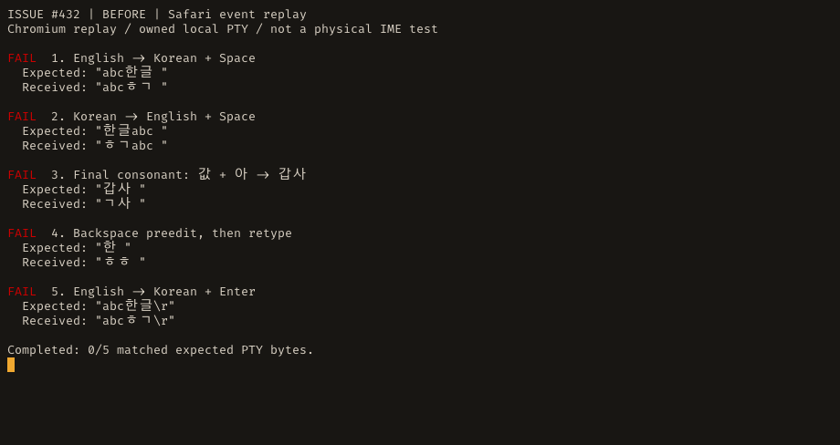
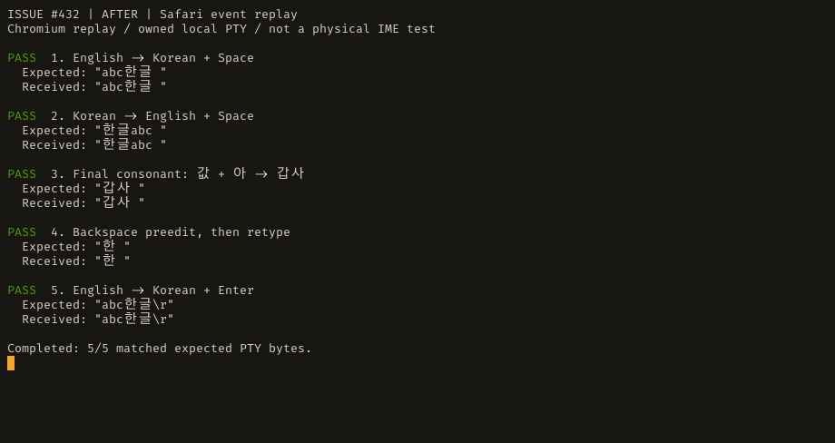

# Terminal input

The terminal keeps xterm.js and the herdr-owned PTY. Mobile input improvements live at the
input boundary; the terminal screen is still rendered from the attach stream.

## Input modes and drafts

Settings → Terminal → Terminal input mode offers Direct typing, the default on every device
with phones included, and Input line, for a line you edit before sending. The key bar's keyboard
button switches modes too, on a touch screen only: a desktop changes the mode in Settings.
Settings → Shortcuts can change each app action's binding or return its keys to the terminal.
Bindings default to Mod+Shift, which leaves Ctrl+key to the pane; a recorded plain Ctrl/Alt chord
takes that key from the pane only after Save anyway. The hold-to-dictate binding remains fixed. Conflicts include the legacy New workspace
alias, and Reset restores the defaults. Palette hints reflect the saved bindings and disappear
when a binding is off. Known browser/OS reservations are marked; delivery still depends on the
browser, OS and installed-app mode. These settings belong to this browser, not the remote PC.
Global bindings do not replace focus-local list/tab controls or text-field selection keys.

The input line keeps its unsent text per `paneStorageId(machineId, paneId)`, including across
lens changes and reloads. Storage refusal falls back to memory for view changes. Pending sends
are shared across mounts, so switching modes cannot submit the same pending line twice. A late
acknowledgement removes only an unchanged sent prefix; replacement text stays even if it happens
to equal the text sent before it. Editing remains available while disconnected; sending does not.
Passwords continue to use the separate non-persistent secret-input path.

Chat Send during work asks a `pending-input` bridge to retain an identified message until the
current response ends. The same server ID is claimed by automatic delivery or a pending row's
explicit send-now action. The bridge checks its original connection, attachment, agent and
visible prompt before input and Enter; each automatic next message also waits for evidence that
the preceding turn started and finished, and an explicit send refused in between does not end that wait. It never sends native Tab and then resends that text.
Tab/workspace navigation on the same PC retains the original pane attachment while its automatic
queue waits.
A page left for another address ends its connection at `pagehide`, also when the browser keeps the
page for Back (the back/forward cache): its queue is then lost like any closed connection's, and the
page connects again when it is shown.
Pending acceptance is distinct from a committing-key receipt. Connection loss, actual pane detachment
and observe mode pause the pending list; reconnect or reload cannot rearm it. Losing a pane
lease permanently cancels its in-flight send, even if that connection rejoins the same attachment
or returns to interact before Enter. A queue request that arrives after the agent finishes uses
the same guarded paste-and-Enter path; one that finds no agent in front of the pane is refused,
and nothing is typed into the program there; one that finds an earlier message still waiting takes
its place behind it. The checks read the pane's live screen, not a viewport scrolled into its
history, and leave a model list alone even when no reader could read it, since Enter there saves
a default. An uncertain delivery never retries automatically. Secret
input remains outside this path, and legacy held messages retain their explicit Send now/Discard
recovery. Older bridges cannot silently turn a working queue request into immediate input. Send now delivers through the existing paste-and-Enter
path; each agent controls when it consumes that input. It is not a native app-server steering API.

Direct input arriving before readiness or during a disconnect is held for explicit Send/Discard.
An IME may commit several code points at once, so printable chunks (including emoji) are retained.
Control sequences are left out, never saved for later execution, and not counted: xterm's own
answers to a program (cursor position, focus, mouse) arrive the same way. Send transmits the held
text alone, without an Enter typed meanwhile. The draft holds 1,024 characters; text past that is
left out whole and the notice says some input was left out, also when nothing else is held. No
draft is replayed on reconnect. The chat message box's Send, tapped during composition,
finishes the word the same way, with the same notes, and sends the box as shown. The input-line
Send tapped during composition finishes the word itself (a blur and refocus inside the tap, which
ends the composition in Chrome and keeps the keyboard up) and sends the committed line, read from
the draft; "Finishing the word…" shows only while the word is still open after the tap. A keyboard
that still does not commit within 300 ms of the tap (a fixed deadline, which a chain of new
compositions does not extend) gets the tap withdrawn with "Finish the word, then send.", and a later
commit sends nothing. A terminal that drops meanwhile withdraws the tap at once with "Not sent: the
terminal is disconnected.", even if it reconnects within the wait. A word that commits empty (the
preedit deleted or cancelled) sends nothing, not a bare Enter.
The key bar waits only for a direct-typing (xterm) composition, so a key cannot overtake xterm's
pending commit. A composition in the input line leaves the key bar live: Esc, ^C and the arrows
go to the pane at once, Ctrl, Alt and Shift arm, and the line's unfinished text stays where it is.
Only the switch to direct typing waits for it, so the line is not removed mid-word.

The key bar defaults to Esc, Tab, ^C, Ctrl, Alt, Shift, Enter and the arrows. Esc, Tab and ^C
come first so they stay reachable without scrolling on narrow phones.
Settings → Terminal → Key bar → Edit key bar opens the complete list: add or remove keys, move each key up or
down, and register a custom combination such as Ctrl+W. The catalog includes editing keys and
F1–F12; a custom combination can use any single printable character, including space and `+`.
Existing extra-key preferences migrate to the same visible order. Restore defaults returns the
default bar; an empty list stays empty. Saved custom layouts keep their order.
The keyboard mode button stays first on touch screens. App actions belong in the header and
menus, not this terminal-input row.
Ctrl, Alt and Shift stay held until tapped again and can be combined. Removing a modifier button
clears its held state immediately. Ordinary key buttons use the held modifiers, while saved
combinations send exactly their configured modifiers without changing the held state.
Holding an arrow (↑ ↓ ← →), ⌫, Del, Home, End, PgUp or PgDn starts repeating after about
400 ms, then sends a key about every 50 ms until release. A tap still sends exactly one key.
Every repeat uses the same held modifiers or saved combination as a tap, and saved
combinations of these keys repeat too. Esc, Tab, Enter, ^C, F-keys and modifier buttons send
once. A sideways swipe scrolls the row without sending a key. Long presses on key buttons do not open a callout or context menu.
Direct typing and arrow buttons send logical key chords; Herdr encodes them for the
PTY's keyboard protocol. Home/End, Page and Delete/Insert keys use CSI navigation through the attach
stream because Herdr's RPC key parser lacks those names. Paste, IME commits and terminal reports pass through unchanged.
The input line and chat composer send their text as typed. Changing panes, leaving the
terminal view or disconnecting clears the held modifiers.

On macOS, Cmd+Left and Cmd+Right in direct typing send Ctrl+A and Ctrl+E, moving to the
beginning and end of the input line in shells and agents that use those bindings.
Pending IME text is sent first. Additional modifiers retain xterm's behavior; the input line
and chat composer keep their native text editing. Ctrl+Left and Ctrl+Right are sent as xterm
sends them on every platform, so a program in the pane that binds them (tmux, an editor) still
receives them; Option+Left and Option+Right move by word.

## Readiness and failures

A server advertising `input-ready` sends `{type:"input-ready", pane_id}` only after the attach's
initial output has passed refusal detection, or when an existing ready attachment is joined.
`ready:false` revokes readiness when that attachment ends or retries. A mirrored attachment uses
the existing RPC input path. Legacy unattached mirror input remains serialized with submits.
Clients talking to an older bridge use its first output, after capabilities are known, as the
compatibility signal. A screen frame alone does not establish readiness on a new bridge.

`input_not_ready` reports a rejected PTY input. `input_failed` reports an RPC or local sidecar
write failure; the UI displays it outside the terminal stream. These are not acknowledgements
that the application consumed individual keystrokes. Failed input is never automatically retried.
The new readiness frame is also implemented in the website demo transport.

## Verification

- `bun run test:unit`: multi-codepoint held input, size/control boundaries, owner isolation,
  replacement edits before acknowledgements, shortcut overrides/conflicts, and old/new bridge readiness.
- `bun run test:integration`: actual UTF-8 input through the owned PTY into a file, non-attached
  client rejection, attach refusal/resume, mirror ordering, disconnect and sidecar lifecycle.
- `bun run build && bun scripts/terminal-input-regression.ts`: focused browser checks for desktop
  mode switching, pane and reload persistence, an unfinished composition, unmount during composition,
  phone key-bar Esc and ^C (and a held direct-typing toggle) while the input line composes,
  pending-send remounts, replacement text, shortcut customization, first held-input persistence,
  readiness delay, an xterm composition commit, batched commits before punctuation, and Korean
  final-consonant movement. Submit/input interception isolates UI assertions;
  contract tests separately verify real delivery.
- `bun run test:ui`: includes those checks plus the existing mobile, clipboard, secret-entry,
  reconnect, prompt, queue and viewport checks. `UI_EVIDENCE_DIR` saves screenshots.
- `bun run build && bun scripts/terminal-safari-ime-regression.ts`: replays Safari's recorded
  non-composition Hangul replacement events in Chromium, including commit keys, final-consonant
  movement, deletion, paste, blur and pane reset. Also included in `bun run test:ui`.
- `bun run build && bun scripts/terminal-command-arrows-regression.ts`: Cmd+Left/Right line
  movement, exact bytes and real readline cursor positions, IME ordering, repeat, modifier,
  unchanged Ctrl+arrows, Windows and Linux checks.
  Uses Chromium with a simulated Mac platform, not native macOS Safari or an OS IME.
- `bun scripts/file-viewer-regression.ts`: existing navigation and touch regressions.

Synthetic composition events exercise event handling, not a real Samsung/Gboard/iOS IME.
Validate rapid Hangul, final-consonant movement, Enter, Backspace, dictation, keyboard-app round
trips and pane changes on those keyboards before claiming universal IME compatibility.

## Upstream findings and limits (2026-10-03)

- [xterm #6089](https://github.com/xtermjs/xterm.js/issues/6089) and
  [PR #6090](https://github.com/xtermjs/xterm.js/pull/6090): rapid composition under renderer load;
  the proposed patch is unmerged. Stock 5.5.0 was independently reproduced dropping both syllables
  of `니다.` when completions and punctuation arrive before deferred timers. A limited backport
  drains pending commits in order, uses the live selection end for interrupted compositions, and
  tracks emitted offsets to prevent duplicates. It reads corrected DOM text rather than stale
  `compositionend.data`, retaining the `핫 → 하세` case. The readable source patch is in `patches/`;
  Vite builds that source through `scripts/build-xterm.ts` so the patch is present in the shipped
  app, not just unused TypeScript. Version changes fail closed until the patch is revalidated.
  The queue/watermark approach follows @joonhoekim's proposal in #6090 (MIT); the backport targets
  5.5.0 and is maintained here pending an upstream release. Reset/disposal also invalidate deferred
  composition work so old input cannot enter a newly selected pane. The app resets in a layout
  effect, before another task can deliver the previous pane's commit.
- Related to [xterm #3600](https://github.com/xtermjs/xterm.js/issues/3600), native Gboard testing
  reproduced stale editor context after Backspace: `가나다 `, two deletes, then `한글` + Enter
  delivered `가나다 \x7f\x7fㅎㅏㄴ글\r`. Clearing the scratch editor on non-composing Backspace
  fixes this case; active compositions and screen-reader mode retain their existing editor behavior.
  This does not declare every case in that umbrella issue resolved.
- [xterm #6078](https://github.com/xtermjs/xterm.js/issues/6078), broader stale-text re-emission,
  remains a separate regression target; this change does not claim to resolve all its triggers.
- [#6084 was retracted](https://github.com/xtermjs/xterm.js/issues/6084#issuecomment-5162622279):
  the reporter identified a missing UTF-8 locale and a harmful custom IME bridge. Do not adopt that
  workaround. Check the spawned session's locale when bytes are corrupted downstream; do not
  replace an explicitly configured user locale blindly.
- [Termux's text input view](https://github.com/termux/termux-tools/blob/master/doc/termux.1.md.in#text-input-view)
  supports retaining an editable input surface alongside direct terminal input. Its
  [composition preview PR](https://github.com/termux/termux-app/pull/5242) is still unmerged.
- Mosh-style speculative local echo is not added. It addresses network responsiveness and needs
  a separate reconciliation design; it does not repair text lost before transmission.

### Native Safari check

#### Replacement events without composition events (#432)

Updated: 2026-10-06

Native Safari 26.6.2 reproduced `abc` → Korean `한글` → Space as `abcㅎㄱ\x20` in xterm's
`onData`, outgoing WS frames and the owned local PTY. A plain textarea and Chrome's native
composition path preserved the Korean text. Safari emitted `insertText("ㅎ")`, then
`insertReplacementText("하")` and `insertReplacementText("한")`, with `isComposing:false`
and no composition events; its keydown 229 arrived after each DOM edit. Stock xterm handling
sent the first jamo and ignored subsequent replacements.

The 5.5.0 source patch treats a single Hangul insertion on macOS Safari as local preedit,
tracks the corrected DOM range through replacements and deletion, and commits it before the
next syllable, ordinary key, paste or blur. Reset cancels pending text before a pane change.
Native composition events and screen-reader mode retain their existing paths. The recorded
event replay failed before the patch and passes after it; this is distinct from native IME QA.

The patched build was physically retested on macOS 27.2 with Safari 27.2 and the Korean
2-set input source. In an isolated raw-mode PTY, switching from ABC and typing `abc한글\x20`
delivered that text once and in order. While composing `한`, Backspace changed it to `하`;
typing the final consonant again and Space delivered `한\x20` without a DEL byte or duplicate.
The captured browser events were trusted native events and the terminal's `onData`, outgoing
WebSocket text and PTY bytes agreed for the text input. Safari 27.2 used ordinary composition
events for this run, while the replay above retains the no-composition replacement sequence
captured from Safari 26.6.2. During the Backspace case Safari 27.2 emitted a composing
`keydown` with `keyCode:229` after changing `한` to `하`; its later `keyup` reported
`keyCode:8`. The key Safari 26.6.2 reports for Backspace on its replacement path was not
recorded, so the replay also covers Backspace and Delete reporting their own key codes, before
or after Safari's edit, and punctuation whose keydown 229 arrives before its insertion.

The replay also verifies that changing panes cancels a pending syllable instead of sending it
to the newly selected pane. This pane-change case has not been repeated with the physical IME,
and iPadOS Safari has not been tested. The older remote shell/Codex/omp matrix from #432 was
not rerun, so this evidence is limited to the local owned raw-mode PTY path.

#### Safari 27.0.1: input-source switching and Backspace (#432)

Updated: 2026-10-19

On a MacBook Air with macOS 27.0.1 and Safari 27.0.1, `scripts/terminal-ime-diagnostic.ts` traced
an owned raw-mode PTY while macOS keyboard events went through the Korean 2-set input method
(posted at the HID event tap, the terminal focused through Accessibility). This Safari used the
replacement path above (`insertText` then `insertReplacementText`, keydown 229 after each edit, no
composition events), not the composition events Safari 27.2 used. Switching from ABC with
Control+Space or the input menu, the PTY received `abc한글 `, `abc 안녕하세요\r`, `한글abc `,
`갑사 `, `한\r` and, with one Backspace inside the syllable, `한 `; `onData`, outgoing WS text and
the PTY bytes agreed. Caps Lock was not tested: a synthesized Caps Lock does not trigger the
"switch to and from ABC" toggle, which only a physical key does. Selecting the source with
`TISSelectInputSource` from an SSH process sometimes left the next keys in ABC in a plain textarea
too, so it is not a reliable harness.

Backspace lost a press. Once 한 was down to ㅎ, the third Backspace made Safari send an unchanged
`insertReplacementText("ㅎ")` (the input method committing the jamo) and then a keydown with
`keyCode` 8, whose default deletes it. The patch read the unchanged replacement as an edit Safari
had already applied for that key and cancelled the keydown, so 한 and four Backspaces sent
nothing to the pane where a plain textarea deleted one more character. An unchanged replacement
no longer counts as an applied edit: the same keys now send one DEL (`한` + four Backspaces +
Space delivered `\x7f\x20`, before the change `\x20`; `한글` + four delivered `한\x7f\x20`). The
Safari replay covers it with the recorded order.

When blur or paste commits an active replacement before its keydown arrives, that commit also
clears the pending-edit key marker, so the next real Backspace/Delete is not swallowed. This
does not clear the marker when deletion already emptied the preedit: its following keydown
must still be cancelled. Normal Safari ordering is unchanged: each edit's keydown consumes the
marker before the next key's beforeinput.

The remote-PC relay (`server/machine-relay.ts`) forwards a browser's input frames unchanged, so
these local results apply to a remote pane's client side; the remote path itself was not rerun.

#### Before/after PTY screenshots

Updated: 2026-10-07

The same five event sequences were replayed against the pre-fix client (`54e5a1f`) and patched
client (`7666d17`). Input travels through the real WS/attach path into an owned raw-mode PTY
process. That process prints the expected string and the bytes it actually receives; the
screenshots capture its terminal output. The first baseline failure matches the earlier native
Safari capture. These are fresh Chromium replay captures, not original native Safari screenshots.
In these examples, `\x20` denotes one trailing space byte.

| Case | Before: received | After: received |
| --- | --- | --- |
| English → Korean + Space | `abcㅎㄱ\x20` | `abc한글\x20` |
| Korean → English + Space | `ㅎㄱabc\x20` | `한글abc\x20` |
| Final consonant: 값 + 아 | `ㄱ사\x20` | `갑사\x20` |
| Backspace preedit, then retype | `ㅎㅎ\x20` | `한\x20` |
| English → Korean + Enter | `abcㅎㄱ\r` | `abc한글\r` |

**Before — all five cases fail:**



**After — all five cases pass:**



The [comparison data](screenshots/safari-ime/comparison.json) retains the expected and actual
strings with their build revisions. To regenerate after building each checkout:

```sh
UI_EVIDENCE_DIR=evidence/safari-ime \
  bun scripts/terminal-safari-ime-evidence.ts /path/to/before/dist /path/to/after/dist
```

The command asserts the known baseline failure and all five patched outcomes, saves PNG/JSON
artifacts, and closes its owned workspaces and servers. It refuses `HERDR_TEST_LIVE=1`.

#### Recording a native English-to-Korean transition (#432)

Updated: 2026-10-06

```sh
bun scripts/terminal-ime-diagnostic.ts
```

Open the printed loopback URL in Safari. In **Native IME control**, type `abc`, switch to
the macOS Korean input source, type `한글`, then Space. Repeat in **Terminal input**.
Use the actual keyboard/IME: pasted Korean, WebDriver text insertion and synthetic composition
events do not exercise the input-source transition. Record the input-source switching method
(Caps Lock, Control+Space or the input menu) with the result. Chrome is a useful control.

The command builds the real client into a temporary directory with diagnostic-only hooks. It
creates a raw-byte capture process in an isolated `herdr-web-ui-test-ime` workspace; it never
attaches to a user's pane. `HERDR_TEST_SESSION` may select another isolated session and
`HERDR_TEST_LIVE=1` is refused. The ordinary app build has no trace hooks or recording endpoint.

The printed artifact directory contains `events.ndjson` (DOM composition/key/input events,
textarea values and selections, xterm `onData`, and outgoing WS `input` frames), `received.bin`
(the bytes delivered to the owned local PTY), and `run.json`. Ctrl+C or the 15-minute deadline
closes the owned workspace and servers and writes `summary.json`, comparing `onData`, WS text
and received bytes. Artifacts are retained for inspection. The test herdr session can then be
stopped with `herdr --session herdr-web-ui-test-ime server stop` (use the override if set).

Compare the intended text with every boundary, not just the final equality flags: all three
boundaries can agree on already-corrupted input. Mouse reports and bracketed-paste delimiters
may be consumed by the attach layer, so raw equality can also fail for correctly delivered text.
The summary deliberately does not certify native IME correctness. A local recording also does
not certify the remote-PC relay; if local
Safari reproduces the corruption before WS transmission, it isolates a client defect. Otherwise
the remote reproduction still needs its own trace. Do not adopt an input workaround from an
unrelated IME issue without matching the event sequence.

#### Earlier synthetic check

On 2026-10-03, Safari 26.2 on an EA MacBook Air (macOS 26.2), reached through an SSH tunnel
inside Tailscale, passed Unicode text entry, draft reload, direct/line mode switching and the
batched composition regression (`["니", "다", "."]`). The Safari WebDriver session used an
owned test workspace and was deleted afterward. These checks use WebDriver text entry and
synthetic composition events; they do not certify a physical Korean IME or an iOS keyboard.

### Native iOS keyboard check: a held ⌫ (#862)

Updated: 2026-10-18

In the iOS 27.0 simulator (iPhone 18 Pro, Safari, the on-screen keyboard driven by AXe touch
down/up), holding ⌫ for 3 s in direct typing sent one DEL to an owned raw-mode PTY and stopped.
A plain page with textareas showed why: the keyboard repeats ⌫ (keydown `repeat:true` about every
0.1 s) only while the focused field has text, cancelled keydowns included, and not at all in a
field with `white-space: nowrap`, which xterm's stylesheet gives its helper textarea. Opacity,
size, z-index and an opaque element over the field made no difference. On iPhone and iPad the
terminal therefore keeps one space in an otherwise empty helper textarea and sets it to
`pre-wrap`; xterm still sends each ⌫ as DEL and cancels its edit, so the space never reaches
the pane. After the change the same 3 s hold sent 24 DELs, on the English and the Korean
keyboard, and typed text, Space and Enter reached the PTY unchanged. The input line is a plain
field and already repeated. `scripts/key-bar-hold-repeat-regression.ts` checks the field's state
under an iPhone user agent; Chromium cannot repeat an iOS key, so the repeat itself was only
measured in the simulator.

### Native iOS keyboard check: iPhone Hangul

Updated: 2026-10-18

In the iOS 27.0 simulator (iPhone 18 Pro, Safari, on-screen Korean 2-set keyboard driven by AXe
taps, owned raw-mode PTY), direct typing sent 한글 as `ㅎㅏㄴㄱㅡㄹ`, also after English
(`abcㅎㅏㄴㄱㅡㄹ`). A plain textarea composed it: the iPhone keyboard sends each jamo as a keydown
with `keyCode` 0 and its jamo as `key`, then edits the field with deleteContentBackward and
insertText and no composition events, the sequence the iPad hardware keyboard sends (#938). The
xterm patch's replacement path was limited to Mac and iPad platforms; it now includes the iPhone.
Afterwards the same taps delivered `한글 `, `abc한글 `, `하 ` (Backspace inside the syllable),
`갑사 ` (a final consonant moving on), `한\r`, and a fourth Backspace past an emptied syllable as
one DEL. The iPad simulator's on-screen keyboard already composed.
`scripts/terminal-ipad-ime-regression.ts` replays the trace under an iPhone user agent and
platform with `keyCode` 0.

### Native Android/Gboard check

On 2026-10-03, an Android 16 Google Play x86_64 emulator (API 36 revision 7, Pixel 7,
1080×2400 at 420 dpi) ran Chrome **133.0.6943.137** and Gboard
**15.1.08.726012951-preload-x86_64**, with Korean two-bulsik selected. These are the system
image's bundled versions, not a claim about the newest Android Chrome/Gboard releases.

`scripts/android-ime-regression.ts` taps Gboard's actual on-screen keys through ADB; it does
not inject text or composition events for the typing assertions. A plain HTML textarea is the
control, followed by the app's input line and direct terminal. The direct-input oracle is the
raw bytes received by a Node capture process in an owned herdr workspace.

Passed: `한글 ` in the input line, reload persistence, direct word commits, final-consonant
movement (`값` + `아` → `갑사`), Backspace during composition, and three repetitions of
`가나다 ` → Backspace twice → `한글` → Enter. Before the Backspace fix, the last sequence
failed twice; the integrated build produced the exact expected bytes in every recorded trial.
The initial Gboard language-model download must finish before testing: a plain textarea that
only produces compatibility jamo is a fixture failure, not evidence of an app defect. Restart
Gboard after that download if necessary.

To repeat, boot an owned emulator with the same screen geometry, choose Korean two-bulsik in
Gboard, enable Chrome command-line support, build the app, then run:

```sh
ANDROID_IME_SERIAL=emulator-5580 \
ANDROID_ADB=/path/to/android-sdk/platform-tools/adb \
UI_EVIDENCE_DIR=/tmp/herdr-android-evidence \
bun scripts/android-ime-regression.ts
```

The script refuses physical-device serials, creates and closes its own workspace/server and
reverse forwarding, and saves native screenshots plus event evidence when requested. The caller
owns emulator startup/shutdown. Samsung Keyboard, newer Gboard/Chrome builds, iOS keyboards,
voice recognition and foldable posture still require separate checks.
